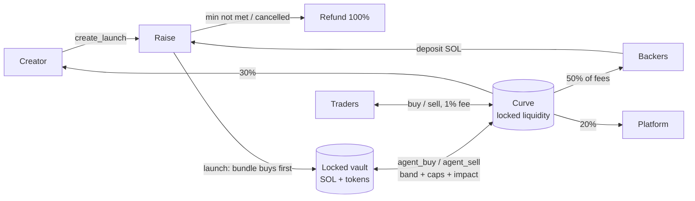

# holdfast

A Solana memecoin launchpad where every launch is backed by a **bundle that can never be dumped**.
Backers fund the bundle before launch; at launch it buys the first slice of supply and is locked
forever in an on-chain vault. A rate-limited agent trades the vault — buying dips, selling rallies —
and backers earn a share of every trading fee for as long as the token trades.



## What's different from the original plan (and why)

| Original plan | This build | Why it's better on Solana |
|---|---|---|
| Meteora DBC curve + graduation to DAMM v2, custom vault CPI-ing into it | Own constant-product curve with virtual SOL inside the same program; **no graduation** | No migration event to snipe, no LP tokens that could ever be pulled, no cross-program account bloat for agents, one audited surface instead of three. Liquidity is permanently locked by construction. |
| Bundle buys "in the same transaction" as creation | Trading is closed until `launch`, which executes the bundle buy **before any public trade can exist** | Same guarantee (nobody can front-run the bundle) without a giant create transaction. |
| Agents limited by "hourly limits" | On-chain **EMA band** (buy only ≥2% under EMA, sell only ≥2% over), **cost-basis rules** (sell only above the vault's average cost + band; buy only at/below average cost, or buy back with sell proceeds below the average sell price), **per-window caps** as % of vault, **max price impact per trade**, fee-free, can only move value between the launch's own curve and vault | The agent is provably counter-cyclical, the vault never realizes a loss and can't be steered into buying high, and nothing can be extracted even if the agent key leaks. |
| Platform settings apply globally | Every launch **freezes its fee split and agent limits at creation** (`Launch.terms`) | Backers know exactly what they signed up for; the admin can't redirect fees on live launches. |
| SOL or USDC deposits | SOL only | The curve is SOL-quoted; USDC would add a swap leg and an oracle. |
| Metaplex metadata | Token-2022 with on-mint metadata, fixed 1B supply, mint authority revoked, no freeze authority | No external metadata program, verifiable fixed supply. |
| Whitelist | Merkle-root whitelist (member list published in the metadata JSON) | O(1) on-chain storage for any list size. |

## Repository

| Path | What |
|---|---|
| `programs/moshsol` | Anchor 0.31 program (raise → launch → curve + vault + agents + fee accounting) |
| `tests/program` | litesvm integration tests (time travel for deadlines/windows, invariants after every step) |
| `packages/sdk` | `@holdfast/sdk`: IDL, PDAs, bigint curve math mirroring the program, ix builders, event parser, merkle whitelist, formatters |
| `apps/indexer` | Data backend: event indexer (backfill + reconnecting live logs + poller, chain-reset detection), SQLite, REST + WebSocket API, rate-limited image/metadata uploads |
| `apps/agent` | Vault agent: mirrors on-chain EMA/window math, sizes trades to pull price back toward the EMA within limits, status API |
| `apps/web` | Next.js site: explore, create, raise/launch/trade pages, portfolio, agent transparency, docs |
| `scripts` | `localnet.sh` + `localnet.mjs` (validator), `setup.ts` (platform init), `seed.ts` (demo data), `simulate.ts` (live traffic), `preflight.ts` (dev checks) |

## Program

Instructions: `initialize_platform`, `update_platform`, `set_fee_recipient`, `set_agent_authority`,
`propose_admin` / `accept_admin` (2-step handover to a multisig), `create_launch`, `deposit`,
`cancel_launch`, `refund`, `launch`, `buy`, `sell`, `agent_buy`, `agent_sell`, `claim_backer_fees`,
`claim_creator_fees`, `sweep_platform_fees`.

Guarantees enforced in code (see `programs/moshsol/src/constants.rs` for hard caps the admin can never exceed):

- **Vault is locked.** No instruction transfers vault SOL or tokens anywhere except the launch's own curve (`agent_*`).
- **Agent can't go rogue.** Only `platform.agent_authority` may call `agent_*`. Every agent trade is fee-free and must pass all of:
  EMA band (buy ≤ EMA×(1−band), sell ≥ EMA×(1+band); EMA weight `dt/(dt+period)` so it can never be snapped to a held price),
  cost basis (sell fill ≥ vault average cost×(1+band); buy fill ≤ average cost, or a buy-back funded only by earlier sell proceeds at ≤ average sell price×(1−band)),
  per-window caps (≤20% of vault per window, window ≥5 min) and max impact per trade (≤10%). Admin can pause agents (circuit breaker) but cannot unlock funds.
- **No atomic sandwiches.** An agent trade can't run in a slot that already saw a public trade on that launch, and no public trade can follow it in the same slot, so nobody (including whoever holds the agent key) can wrap a vault trade in one transaction or Jito bundle. What a leaked agent key *can* still do is trade within the rules above — bounded per window, never withdraw — until the admin pauses agents and rotates the key (`set_agent_authority`, admin = multisig on mainnet).
- **Frozen terms.** Fee split, trade/launch fee and agent limits are copied into the launch at creation and never change. `create_launch` carries the terms the creator reviewed (plus virtual SOL and a max create fee) and fails with `TermsChanged` if the platform changed them in between. Trade fee is bounded to 0.3%–2%.
- **Fixed supply.** 1,000,000,000 tokens minted to the curve at creation, mint authority revoked in the same instruction, no freeze authority.
- **Refunds.** Raise below minimum at deadline, or cancelled by the creator → every backer can refund 100% (backer account closed, rent returned). Pausing never blocks refunds, trading or claims.
- **Accounting.** All launch SOL sits on the launch PDA; `lamports ≥ rent + raise escrow` (raising/refunding) or `rent + curve + vault + unclaimed fees` (live), with equality unless someone donates lamports/tokens directly (donations are never counted and stay stuck). Tests assert equality after every step.
- **Fees.** 1% on public trades, rounded up so no trade is fee-free: 50% backers (pro-rata accumulator, claim any time), 30% creator, 20% platform. The split can never drop below 25% for backers or 10% for creators. 1% launch fee on the raise. Flat create fee (anti-spam). All bounded by hard caps.
- **Beta caps.** `max_raise_lamports` bounds a new launch's `raise_max` and `max_wallet_deposit_lamports` bounds any one wallet's deposit on top of the creator's own cap (0 = none; set by `MAX_RAISE_SOL` / `MAX_WALLET_SOL` in setup).
- **Deployment.** Only the program's upgrade authority can run `initialize_platform` (no front-running after deploy).

## Run it locally

Prereqs: Rust + Solana CLI (Agave) + Anchor 0.31 in WSL/Linux/macOS for the program and the validator;
Node 22+ and pnpm 10 for everything else (on Windows the validator runs in WSL, the rest natively).

```bash
anchor build                 # WSL/Linux, once and after every program change
cargo test -p moshsol-tests  # 16 litesvm tests; needs target/deploy/moshsol.so

pnpm install
pnpm localnet                # terminal 1: validator (through WSL on Windows); resumes its ledger
pnpm setup:localnet          # once per fresh chain: initializes the platform, writes .localnet/
pnpm dev                     # terminal 2: indexer :8787 + agent :8788 + web http://localhost:3000
pnpm seed:localnet           # optional: demo launches, deposits and a few minutes of trading
pnpm simulate:localnet       # optional: endless organic-looking traffic (see below)
```

`pnpm dev` first runs a preflight that refuses to start — printing the command that fixes it — when the
validator is unreachable, the program is not deployed, the platform is not initialized, the agent key is
missing or a port is taken. The three services then share one terminal with colored `[indexer]`,
`[agent]`, `[web]` prefixes; if one exits, the others are stopped too.

| Command | What it does |
|---|---|
| `pnpm localnet` | `scripts/localnet.sh` via `wsl` on Windows, `bash` elsewhere. Keeps `~/.moshsol-ledger` across restarts; `pnpm localnet --reset` starts a fresh chain (required after `anchor build`: the program is loaded at genesis). |
| `pnpm reset:localnet` | Fresh chain in one go: stops the validator, restarts it on a new ledger in the background (log in `.localnet/validator.log`), wipes the indexer DB (a running indexer re-indexes by itself instead), runs `setup:localnet`, then `seed:localnet` if the indexer is up. |
| `pnpm stop:localnet` | Stops a running validator. |
| `pnpm dev` | Preflight, then indexer + agent (tsx watch) and `next dev` via `concurrently`, fail fast. |
| `pnpm start` | Production-style: preflight, `next build`, then indexer/agent `start` + `next start`. |
| `pnpm simulate:localnet` | Traffic simulator (localhost RPC only). |
| `pnpm preflight` | The checks `dev`/`start` run first (RPC, program, platform, agent key, free ports). |
| `pnpm dev:indexer` / `dev:agent` / `dev:web` | One service. |
| `pnpm typecheck` | Every workspace. |

On localnet the web app offers a burner wallet and a "Get test SOL" button; Phantom/Solflare/Backpack
work too (point them at `http://127.0.0.1:8899`).

### Traffic simulator

`pnpm simulate:localnet` keeps the site alive through the real program and the indexer's upload endpoint:

- trades every live launch from 10 trader wallets — momentum chasers, mean-reverters (against the
  on-chain EMA) and noise traders — with log-normal sizes (median 0.15 SOL) and occasional whale pumps
  and dumps, which is what makes the vault agents step in;
- every ~5 minutes opens a raise with a generated name and SVG mascot, fills it from 6 backer wallets and
  launches it once the minimum is met and it has been visible for 2 minutes;
- backers and creators claim their fees from time to time.

It runs about 3 transactions per 10 s, keeps its wallets in `.localnet/sim/` (topped up by airdrop), refuses
to run unless `RPC_URL` is a localhost validator, and stops cleanly on Ctrl+C with a summary.

### Environment

Indexer (`apps/indexer`):

| Variable | Default | |
|---|---|---|
| `PORT`, `HOST` | `8787`, `127.0.0.1` | HTTP API + `/ws` |
| `RPC_URL` | `http://127.0.0.1:8899` | |
| `WS_URL` | RPC port + 1 | `logsSubscribe`; reconnects with backoff (1 s → 30 s), the 4 s poller covers gaps |
| `DB_PATH` | `apps/indexer/data/indexer.db` | SQLite (WAL). Chain data re-indexes by itself, but the file also holds comments and profiles — deleting it loses those |
| `FILES_DIR` | `apps/indexer/data/files` | Uploaded images + metadata JSON |
| `PUBLIC_URL` | `http://127.0.0.1:$PORT` | Base of the URIs stored on-chain; must be reachable by browsers and wallets |
| `RATE_LIMIT_PER_MIN` | `1200` | Per-IP requests per minute across all routes (`0` = off); 429 + `Retry-After` |
| `UPLOAD_LIMIT_PER_MIN` | `20` | Per-IP `POST /api/upload` + `/api/upload/image` per minute (`0` = off) |
| `COMMENT_LIMIT_PER_MIN` | `5` | Comments per wallet per minute (`0` = off) |
| `SOCIAL_IP_LIMIT_PER_MIN` | `20` | Signed writes (comments, profile updates) per IP per minute (`0` = off) |
| `ADMIN_TOKEN` | unset | Enables comment moderation (`DELETE /api/comments/:id` with header `x-admin-token`); unset = disabled |
| `TRUST_PROXY` | off | Behind a reverse proxy, so per-IP limits see the client from `X-Forwarded-For`: a comma list of trusted proxy IPs/CIDRs or `loopback`/`linklocal`/`uniquelocal` (clients can't spoof), or `1` = trust every hop |
| `STORAGE` | `local` | Where `POST /api/upload` + `/api/upload/image` store files: `local` = `FILES_DIR` served under `PUBLIC_URL/files`; `arweave` = permanent Arweave via [ArDrive Turbo](https://docs.ardrive.io/docs/turbo/), URIs `https://arweave.net/<id>`, paid in SOL. Old `/files` URIs keep being served and indexed either way |
| `ARWEAVE_KEYPAIR_JSON` / `ARWEAVE_KEYPAIR` | — | `STORAGE=arweave`: Solana secret key (JSON byte array; `_JSON` for Railway secrets, else a file path) paying for uploads. Startup fails without one |
| `ARWEAVE_NETWORK` | `mainnet` | `dev` = ar.io testnet sandbox paid with devnet SOL (data ephemeral, served from `https://ar-io.dev/<id>`) |
| `ARWEAVE_RPC_URL` | `RPC_URL` | Solana RPC for the SOL top-up transfers (`dev`: a devnet RPC) |
| `ARWEAVE_DAILY_BUDGET_SOL` | `0.25` | Hard cap on SOL sent to Turbo per UTC day, kept in the DB (survives restarts). Items ≤105 KiB within the key's Turbo free allowance cost nothing; otherwise credits are bought only when the balance can't cover an upload (deficit + 10%). Over budget → 503 until 00:00 UTC |
| `RPC_PROXY` | off | `1`: `POST /rpc` (JSON-RPC, single + batch ≤20, 64 KB body, 15 s upstream timeout) → `RPC_URL` and `GET /rpc-ws` (PubSub) → `WS_URL`, so a keyed RPC never reaches browsers. Only the methods the web app uses are forwarded (account/balance reads, blockhash, send/simulate, signature status, `account`/`signature`/`slot` subscriptions); anything else (e.g. `getProgramAccounts`) gets JSON-RPC `-32601`. `/rpc-ws`: ≤10 connections per IP, ≤32 subscriptions per connection |
| `RPC_PROXY_LIMIT_PER_MIN` | `600` | Per-IP JSON-RPC calls per minute through the proxy (each batch entry and WS request counts; `0` = off). The proxy is exempt from `RATE_LIMIT_PER_MIN` |
| `LOG_LEVEL` | `info` | `debug` adds poller catch-ups and websocket retry attempts |

Every endpoint, the signed-message scheme for comments/profiles, rate limits and WebSocket messages are documented in
[`apps/indexer/API.md`](apps/indexer/API.md). `GET /api/health` → `{ ok, slot, lastIndexedSlot, lagSlots, wsConnected,
genesisHash }` (503 when the RPC is unreachable or the first sync hasn't finished).

Agent (`apps/agent`):

| Variable | Default | |
|---|---|---|
| `RPC_URL` | `http://127.0.0.1:8899` | |
| `AGENT_KEYPAIR` | `.localnet/agent.json` | Must be the platform's agent authority to trade |
| `STATUS_PORT`, `STATUS_HOST` | `8788`, `127.0.0.1` | `GET /status`: latest decision per live launch |
| `POLL_MS` | `4000` | |
| `DRY_RUN` | off | `1`: decide and report, never send |
| `MIN_TRADE_LAMPORTS` | `10000000` | 0.01 SOL: smaller buys/sells are skipped |
| `MAX_FRACTION_PER_TRADE` | `0.5` | Share of the remaining window budget one trade may use |
| `COOLDOWN_MS` | `15000` | Per launch after a trade (errors back off exponentially up to 5 min) |
| `SLIPPAGE_BPS`, `PRIORITY_MICROLAMPORTS` | `50`, `0` | |

Web (`apps/web`, read at build time):

| Variable | Default |
|---|---|
| `NEXT_PUBLIC_CLUSTER` | `localnet` (`devnet`, `mainnet-beta`; burner wallet + faucet only on test clusters) |
| `NEXT_PUBLIC_RPC_URL`, `NEXT_PUBLIC_WS_URL` | `http://127.0.0.1:8899`, `ws://127.0.0.1:8900` |
| `NEXT_PUBLIC_INDEXER_URL` | `http://127.0.0.1:8787` (also fetched server-side for OG images) |
| `NEXT_PUBLIC_AGENT_URL` | `http://127.0.0.1:8788` |
| `NEXT_PUBLIC_SITE_URL` | `http://localhost:3000` (public origin for absolute share/OG URLs) |

Scripts: `RPC_URL`, `KEYS_DIR` (default `.localnet`), `INDEXER_URL` (seed/simulate), `PROFILE=production`
(setup: hourly agent windows), `SEED_TRADE_SECS` (seed, 150). Simulator: `SIM_INTERVAL_MS` (3000, mean pause
between transactions), `SIM_TRADERS` (10), `SIM_BACKERS` (6), `SIM_MEDIAN_TRADE_SOL` (0.15), `SIM_WHALE_PROB`
(0.04), `SIM_RAISE_EVERY_S` (300), `SIM_MAX_RAISING` (1), `SIM_CLAIM_EVERY_S` (90). Validator (`localnet.sh`):
`LEDGER` (`~/.moshsol-ledger`), `LEDGER_LIMIT` (1,000,000 shreds), `UPGRADE_AUTHORITY` (`.localnet/admin.json`).

### Troubleshooting

- **Windows can't reach the WSL validator.** Windows talks to it on `127.0.0.1:8899/8900` through WSL
  localhost forwarding. If `pnpm dev` says the validator is unreachable while it runs, make sure
  `%UserProfile%\.wslconfig` doesn't disable it (`localhostForwarding=true`, or `networkingMode=mirrored`),
  run `wsl --shutdown`, start `pnpm localnet` again, and check with
  `curl -s -X POST -H "content-type: application/json" -d "{\"jsonrpc\":\"2.0\",\"id\":1,\"method\":\"getHealth\"}" http://127.0.0.1:8899`.
- **Chain reset.** After `pnpm localnet --reset` / `pnpm reset:localnet` the genesis hash changes. The indexer
  checks it at start, every 30 s and after every RPC or websocket outage; on a mismatch (or when its cursor
  vanished from retained history) it wipes its DB (comments included; profiles are kept), re-indexes and pushes
  `{ type: "reset" }` so open pages refetch. Re-run `pnpm setup:localnet` on the new chain (`reset:localnet` does).
  Wallets keep their keys but have 0 SOL on the new chain.
- **Validator restarts.** The indexer reconnects its websocket with backoff and the agent retries with
  backoff; `GET :8787/api/health` shows `wsConnected` and `lagSlots` (≈0–10 when healthy).
- **History gaps.** `solana-test-validator` only keeps `--limit-ledger-size` shreds (its default, 10,000, is
  ~3 minutes); `localnet.sh` raises it to 1,000,000 (hours). Trades older than the node's history can't be
  backfilled after a long indexer outage; launches themselves are always rediscovered from their accounts.
- **Burner wallet.** Wallet modal → "More options" → Burner Wallet. The key lives in the browser's local
  storage (clear site data for a fresh one) and is for test clusters only; "Get test SOL" airdrops to it.
- **Phantom on localnet** shows stale balances or "blockhash not found" after a chain reset: switch its
  network away and back to the custom `http://127.0.0.1:8899` RPC.
- **Agent doesn't trade.** `GET :8788/status` gives the reason per launch: inside the EMA band, cost-basis
  rule, window budget exhausted, cooldown, or a trade below `MIN_TRADE_LAMPORTS`.
- **429 from the indexer.** Raise `RATE_LIMIT_PER_MIN` / `UPLOAD_LIMIT_PER_MIN` (everything on one machine
  shares the 127.0.0.1 budget).

## Live deployment (Railway)

Railway project `moshsol` runs two environments of the same three services (`indexer`, `agent`, `web`).
Program id on every cluster: `EduEwYBkqWCNbZ95nQVeakY8d4tGKM2qaAk7kuW76AMQ` (keypair `target/deploy/moshsol-keypair.json`).

### `mainnet` environment (mainnet-beta, deploys from `master`)

| | |
|---|---|
| Site | https://web-mainnet-80e3.up.railway.app |
| Indexer API | https://indexer-mainnet-bd1f.up.railway.app (`/api/health`; `/rpc` + `/rpc-ws` proxy the Helius RPC for browsers) |
| Agent status | https://agent-mainnet.up.railway.app/status |
| Deployer / initial admin + upgrade authority | `EVN2gPRLh4Yymj7w6yh9u7yLf7CU8dBTfnTgBzNEYJ4G` (`.mainnet/admin.json`), handed to the Squads vault by `pnpm handoff` |
| Multisig members (2-of-3) | `.mainnet/member-{1,2,3}.json` — rotate them to separate hardware wallets in the Squads app |
| Agent authority | `FvbdC4n4qXu8JoVLDeb5m8hT8pDSjXFKBCWx322LtWKP` (`.mainnet/agent.json`, Railway `AGENT_KEYPAIR_JSON`) |
| Arweave uploader | `BCMaXCQ85twN4unAxftvuQQsogmTt7s4s1EG4hYxPTwW` (`.mainnet/uploader.json`, Railway `ARWEAVE_KEYPAIR_JSON`) |
| Beta params | min raise 1 SOL, max raise 50 SOL, max 5 SOL per wallet per raise, create fee 0.02 SOL, 1% trade fee (50/30/20), 1% launch fee |

Launch runbook (WSL for step 1, any OS after):

```bash
CLUSTER=mainnet-beta RPC_URL=<helius-url> bash scripts/deploy.sh      # admin needs ~7.6 SOL at peak, ~3.8 SOL stays as program rent
RPC_URL=<helius-url> KEYS_DIR=.mainnet PROFILE=production MIN_RAISE_SOL=1 CREATE_FEE_SOL=0.02 \
  MAX_RAISE_SOL=50 MAX_WALLET_SOL=5 pnpm setup:localnet
RPC_URL=<helius-url> KEYS_DIR=.mainnet THRESHOLD=2 MEMBERS=<member-1>,<member-2>,<member-3> \
  APPROVER_KEYPAIRS=.mainnet/member-1.json,.mainnet/member-2.json pnpm handoff
```

After the handoff every admin action (`update_platform`, pausing, key rotation, upgrades) is a Squads proposal.

### `production` environment (devnet, deploys from the `devnet` branch)

| | |
|---|---|
| Site | https://holdfast.up.railway.app |
| Indexer API | https://indexer-production-454b.up.railway.app (`/api/health`) |
| Agent status | https://agent-production-47e4.up.railway.app/status |
| Program (devnet, previous layout) | `C1c2ggJWMy2Ta4ogc297mGWk7Fj617dAxQr91BJKpTSW` (old keypair backed up as `.devnet/program-C1c2….json`) |
| Platform admin / upgrade authority | `FwYLuQQev8VnGnXySMd7NSJvSYwqhe3tgcdyWzEVpnAs` (`.devnet/admin.json`) |
| Agent authority | `3qLLfTodvtLMSfUmzLMXLwm7L2uQrRz2MsGjEwWmFj2t` (`.devnet/agent.json`, set on Railway as `AGENT_KEYPAIR_JSON`) |
| Treasury | `J2zc2wKWtPE7nGHzSwmpZNEz6qSGpCGoDSVwkjKNrKyn` |

The devnet services are pinned to the `devnet` branch because the deployed devnet program predates the
current account layout. To move devnet to the current program: fund `.devnet/admin.json` with ~7.6 devnet SOL,
`CLUSTER=devnet bash scripts/deploy.sh`, `RPC_URL=https://api.devnet.solana.com KEYS_DIR=.devnet PROFILE=production
MIN_RAISE_SOL=0.05 CREATE_FEE_SOL=0.005 pnpm setup:localnet`, then point the `production` services back at `master`
(the indexer wipes and re-indexes on the program change) and delete the `devnet` branch.

`.devnet/*.json` and `.mainnet/*.json` are the only copies of those keys — back them up; they are gitignored.

Each service is connected to this GitHub repo with its
own Dockerfile (`apps/<service>/Dockerfile`, build context = repo root), a healthcheck, restart on
failure, and watch paths so a push only rebuilds what it touched (`apps/<service>/**`,
`packages/sdk/**`, lockfile):

| Service | Variables | Healthcheck | Notes |
|---|---|---|---|
| `indexer` | `RPC_URL`, `WS_URL`, `PUBLIC_URL` (its own Railway domain), `PORT=8787`, `POLL_MS=8000`, `FULL_REFRESH_MS=30000`, `HOLDERS_TTL_MS=120000`, `CHAIN_CHECK_MS=60000`, `ADMIN_TOKEN` (secret, comment moderation), `TRUST_PROXY=uniquelocal` | `/api/health` | Volume at `/data` (SQLite DB with comments/profiles + uploaded images/metadata). |
| `agent` | `RPC_URL`, `AGENT_KEYPAIR_JSON` (secret), `PORT=8788`, `POLL_MS=10000` | `/status` | Keep ~0.1+ SOL on the agent key for fees. |
| `web` | `NEXT_PUBLIC_CLUSTER=devnet`, `NEXT_PUBLIC_RPC_URL`, `NEXT_PUBLIC_WS_URL`, `NEXT_PUBLIC_INDEXER_URL`, `NEXT_PUBLIC_AGENT_URL`, `NEXT_PUBLIC_SITE_URL`, `PORT=3000` | `/` | Pages are server-rendered with live indexer data. `NEXT_PUBLIC_*` are baked in at build time — redeploy after changing them. |

**Deploying:** push to `master`. Manual deploy of local changes: `railway up --service indexer|agent|web --ci`.
**CI** (GitHub Actions): `CI` typechecks everything and builds the web on every push; `Program`
runs `anchor build` + the litesvm suite when `programs/`, `tests/` or Cargo/Anchor files change.

**Devnet platform params** are set for cheap testing: min raise 0.05 SOL, create fee 0.005 SOL
(`MIN_RAISE_SOL=0.05 CREATE_FEE_SOL=0.005 … pnpm setup:localnet -- --update`). Live launches keep the
terms frozen at their creation.

**RPC note.** Everything runs on the public `api.devnet.solana.com`: it is rate-limited and refuses
`getProgramAccounts` on the token programs, so the indexer reads the real token accounts of the
curve, the vault and every wallet that ever traded (exact balances; wallets that only *received*
tokens by transfer aren't listed). The in-app "Get test SOL" falls back to a faucet.solana.com link
when the public faucet throttles. For real traffic set `RPC_URL`/`WS_URL` on the indexer and agent to a
dedicated provider (Helius, Triton, QuickNode) — keep keyed URLs server-side only; the web's
`NEXT_PUBLIC_RPC_URL` is visible to every visitor. On mainnet set `RPC_PROXY=1` on the indexer and point the
web at it: `NEXT_PUBLIC_RPC_URL=https://<indexer-domain>/rpc`, `NEXT_PUBLIC_WS_URL=wss://<indexer-domain>/rpc-ws`
(server-rendered reads from the web service share one IP there — raise `RPC_PROXY_LIMIT_PER_MIN` if it hits 429s).

## Deploy to another cluster

1. `CLUSTER=devnet bash scripts/deploy.sh` (or `CLUSTER=mainnet-beta`) — creates `.<cluster>/admin.json` on first run; fund it (~7.6 SOL at peak for the ~536 KB program: ~3.8 SOL program rent plus a same-size upload buffer that is refunded after the deploy) and re-run. The admin is the upgrade authority (required to initialize).
2. `RPC_URL=<rpc> KEYS_DIR=.<cluster> PROFILE=production pnpm setup:localnet` (hourly agent windows, 30-min EMA), then fund `.<cluster>/agent.json` for fees.
3. Create the Railway services as above (or any Docker host) pointing at the cluster.
4. Before mainnet: external audit, keep the beta caps (`MAX_RAISE_SOL`, `MAX_WALLET_SOL`) low, use a dedicated RPC behind the indexer's `/rpc` proxy, store uploads on Arweave (`STORAGE=arweave`), and hand the platform admin, the fee recipient and the program upgrade authority to a Squads v4 multisig with `pnpm handoff` ([`scripts/src/handoff.ts`](scripts/src/handoff.ts)):
   ```bash
   export RPC_URL=<rpc> KEYS_DIR=.mainnet MEMBERS=<pk1>,<pk2>,<pk3> THRESHOLD=2
   pnpm handoff --dry-run   # plan + current PASS/FAIL table; sends and writes nothing
   pnpm handoff             # re-run after every approval round; finished steps are skipped
   ```
   | Variable | Default | Purpose |
   |---|---|---|
   | `MEMBERS` | — | Comma-separated member pubkeys; every member gets Initiate/Vote/Execute. |
   | `THRESHOLD` | — | Approvals required (1…members). |
   | `MULTISIG` | — | Reuse an existing Squads v4 multisig instead of creating one; it must match `MEMBERS`/`THRESHOLD` exactly and have no config authority. |
   | `PROPOSER_KEYPAIR` | first `APPROVER_KEYPAIRS` entry | Keypair file (relative to the repo root) of one member; lets the script create the step-3 vault transaction + proposal itself. |
   | `APPROVER_KEYPAIRS` | — | Comma-separated member keypair files (relative to the repo root); each approves the step-3 proposal (skipping ones that already voted) and, once the threshold is met, the first executes it, so one run ends with an all-PASS table. |

   The admin (`$KEYS_DIR/admin.json`) pays for everything. Steps: (1) create the multisig (no config authority, no time lock; create key saved to `$KEYS_DIR/multisig-create-key.json`, `multisig` + `multisigVault` merged into `$KEYS_DIR/config.json`); (2) `propose_admin(vault)`; (3) one vault transaction `[accept_admin, set_fee_recipient(vault)]` plus a proposal — Squads only lets members create these, so either pass `PROPOSER_KEYPAIR`/`APPROVER_KEYPAIRS` or have a member import the printed base58 transaction in the Squads app (TX Builder → *Import a base58 encoded transaction*); with `APPROVER_KEYPAIRS` the script approves and executes it, otherwise members do so at the printed Squads URL; (4) the upgrade authority moves to the vault via the upgradeable loader's `SetAuthority`. The last step prints PASS/FAIL for platform admin, pending admin, fee recipient and upgrade authority (exit 1 until all pass). Authority only ever goes to vault index 0 of a multisig that exists on chain and matches `MEMBERS`/`THRESHOLD`.
