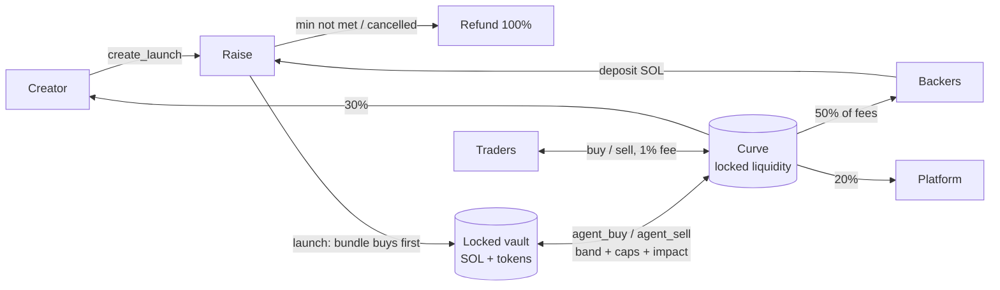

# moshsol

A Solana memecoin launchpad where every launch is backed by a **bundle that can never be dumped**.
Backers fund the bundle before launch; at launch it buys the first slice of supply and is locked
forever in an on-chain vault. A rate-limited agent trades the vault — buying dips, selling rallies —
and backers earn a share of every trading fee for as long as the token trades.



## What's different from the original plan (and why)

| Original plan | This build | Why it's better on Solana |
|---|---|---|
| Meteora DBC curve + graduation to DAMM v2, custom vault CPI-ing into it | Own constant-product curve with virtual SOL inside the same program; **no graduation** | No migration event to snipe, no LP tokens that could ever be pulled, no cross-program account bloat for agents, one audited surface instead of three. Liquidity is permanently locked by construction. |
| Bundle buys "in the same transaction" as creation | Trading is closed until `launch`, which executes the bundle buy **before any public trade can exist** | Same guarantee (nobody can front-run the bundle) without a giant create transaction. |
| Agents limited by "hourly limits" | On-chain **EMA band** (buy only ≥2% under EMA, sell only ≥2% over), **cost-basis rules** (sell only above the vault's average cost + band; buy only at/below average cost, or buy back with sell proceeds below the average sell price), **per-window caps** as % of vault, **max price impact per trade**, fee-free, can only move value between the launch's own curve and vault | The agent is provably counter-cyclical, the vault never realizes a loss and can't be steered into buying high, and nothing can be extracted even if the agent key leaks. |
| Platform settings apply globally | Every launch **freezes its fee split and agent limits at creation** (`Launch.terms`) | Backers know exactly what they signed up for; the admin can't redirect fees on live launches. |
| SOL or USDC deposits | SOL only | The curve is SOL-quoted; USDC would add a swap leg and an oracle. |
| Metaplex metadata | Token-2022 with on-mint metadata, fixed 1B supply, mint authority revoked, no freeze authority | No external metadata program, verifiable fixed supply. |
| Whitelist | Merkle-root whitelist (member list published in the metadata JSON) | O(1) on-chain storage for any list size. |

## Repository

| Path | What |
|---|---|
| `programs/moshsol` | Anchor 0.31 program (raise → launch → curve + vault + agents + fee accounting) |
| `tests/program` | litesvm integration tests (time travel for deadlines/windows, invariants after every step) |
| `packages/sdk` | `@moshsol/sdk`: IDL, PDAs, bigint curve math mirroring the program, ix builders, event parser, merkle whitelist, formatters |
| `apps/indexer` | Data backend: event indexer (backfill + live logs + poller), SQLite, REST + WebSocket API, image/metadata uploads |
| `apps/agent` | Vault agent: mirrors on-chain EMA/window math, sizes trades to pull price back toward the EMA within limits, status API |
| `apps/web` | Next.js site: explore, create, raise/launch/trade pages, portfolio, agent transparency, docs |
| `scripts` | `localnet.sh` (validator), `setup.ts` (platform init), `seed.ts` (demo data) |

## Program

Instructions: `initialize_platform`, `update_platform`, `set_fee_recipient`, `set_agent_authority`,
`propose_admin` / `accept_admin` (2-step handover to a multisig), `create_launch`, `deposit`,
`cancel_launch`, `refund`, `launch`, `buy`, `sell`, `agent_buy`, `agent_sell`, `claim_backer_fees`,
`claim_creator_fees`, `sweep_platform_fees`.

Guarantees enforced in code (see `programs/moshsol/src/constants.rs` for hard caps the admin can never exceed):

- **Vault is locked.** No instruction transfers vault SOL or tokens anywhere except the launch's own curve (`agent_*`).
- **Agent can't go rogue.** Only `platform.agent_authority` may call `agent_*`. Every agent trade is fee-free and must pass all of:
  EMA band (buy ≤ EMA×(1−band), sell ≥ EMA×(1+band); EMA weight `dt/(dt+period)` so it can never be snapped to a held price),
  cost basis (sell fill ≥ vault average cost×(1+band); buy fill ≤ average cost, or a buy-back funded only by earlier sell proceeds at ≤ average sell price×(1−band)),
  per-window caps (≤20% of vault per window, window ≥5 min) and max impact per trade (≤10%). Admin can pause agents (circuit breaker) but cannot unlock funds.
- **Frozen terms.** Fee split, trade/launch fee and agent limits are copied into the launch at creation and never change. Trade fee is bounded to 0.3%–2%.
- **Fixed supply.** 1,000,000,000 tokens minted to the curve at creation, mint authority revoked in the same instruction, no freeze authority.
- **Refunds.** Raise below minimum at deadline, or cancelled by the creator → every backer can refund 100% (backer account closed, rent returned). Pausing never blocks refunds, trading or claims.
- **Accounting.** All launch SOL sits on the launch PDA; `lamports == rent + raise escrow` (raising/refunding) or `rent + curve + vault + unclaimed fees` (live). Tests assert this after every step.
- **Fees.** 1% on public trades: 50% backers (pro-rata accumulator, claim any time), 30% creator, 20% platform. 1% launch fee on the raise. Flat create fee (anti-spam). All bounded by hard caps.
- **Deployment.** Only the program's upgrade authority can run `initialize_platform` (no front-running after deploy).

## Run it locally

Prereqs: Rust + Solana CLI (Agave) + Anchor 0.31 (Linux/WSL/macOS), Node 22+ and pnpm 10.

```bash
# 1. build + test the program (WSL/Linux)
anchor build
cargo test -p moshsol-tests  # 16 litesvm tests; needs target/deploy/moshsol.so from anchor build

# 2. start a local validator with the program (WSL/Linux; keep running)
bash scripts/localnet.sh

# 3. JS workspace (any OS)
pnpm install
pnpm setup:localnet          # initializes the platform, writes .localnet/config.json + keys
pnpm dev:indexer             # http://127.0.0.1:8787
pnpm dev:agent               # status on http://127.0.0.1:8788/status
pnpm seed:localnet           # optional demo launches, deposits and trades
pnpm dev:web                 # http://localhost:3000
```

On localnet the web app offers a burner wallet and a "Get test SOL" button; Phantom/Solflare/Backpack
work too (point them at `http://127.0.0.1:8899`).

## Deploy to devnet / mainnet

1. `CLUSTER=devnet bash scripts/deploy.sh` — creates `.devnet/admin.json` on first run; fund it (~4 SOL) and re-run. The admin is the upgrade authority (required to initialize).
2. `RPC_URL=https://api.devnet.solana.com KEYS_DIR=.devnet PROFILE=production pnpm setup:localnet` (hourly agent windows, 30-min EMA).
3. Run indexer + agent against the cluster (`RPC_URL`, `WS_URL`, `AGENT_KEYPAIR=.devnet/agent.json`), use a dedicated RPC (Helius/Triton) for `onLogs` + `getProgramAccounts`.
4. Build the web with `NEXT_PUBLIC_CLUSTER=devnet NEXT_PUBLIC_RPC_URL=… NEXT_PUBLIC_INDEXER_URL=… NEXT_PUBLIC_AGENT_URL=…`.
5. Before mainnet: external audit, move `admin` to a Squads multisig (`propose_admin` → `accept_admin`), transfer the program upgrade authority to the multisig, keep low `raise_max` caps during beta, and store uploads on Arweave/IPFS instead of the indexer disk.
