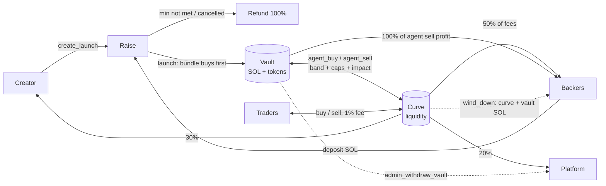

# holdfast

A Solana memecoin launchpad where **backers buy first and share the profit**. Backers fund the bundle
before launch; at launch it buys the first slice of supply — before any public trade can exist — and
sits in an on-chain vault. A rate-limited agent trades the vault — buying dips, selling rallies — and
backers get 100% of its realized profit plus a share of every trading fee for as long as the token trades.
The platform admin (a Squads multisig on mainnet) can withdraw vault funds with `admin_withdraw_vault`;
every withdrawal is on-chain and shown on the launch page.



## What's different from the original plan (and why)

| Original plan | This build | Why it's better on Solana |
|---|---|---|
| Meteora DBC curve + graduation to DAMM v2, custom vault CPI-ing into it | Own constant-product curve with virtual SOL inside the same program; **no graduation** | No migration event to snipe, no LP tokens that could ever be pulled, no cross-program account bloat for agents, one audited surface instead of three. No instruction takes curve liquidity out while anyone outside the curve and vault holds the token (`wind_down` pays it to backers only after that). |
| Bundle buys "in the same transaction" as creation | Trading is closed until `launch`, which executes the bundle buy **before any public trade can exist** | Same guarantee (nobody can front-run the bundle) without a giant create transaction. |
| Agents limited by "hourly limits" | On-chain **EMA band** (buy only ≥2% under EMA, sell only ≥2% over), **cost-basis rules** (sell only above the vault's average cost + band; buy only at/below average cost, or buy back with sell proceeds below the average sell price), **per-window caps** as % of vault, **max price impact per trade**, fee-free, can only move value between the launch's own curve and vault | The agent is provably counter-cyclical, the vault never realizes a loss and can't be steered into buying high, and a leaked agent key can't extract anything. |
| Platform settings apply globally | Every launch **freezes its fee split and agent limits at creation** (`Launch.terms`) | Backers know exactly what they signed up for; the admin can't redirect fees on live launches. |
| SOL or USDC deposits | SOL only | The curve is SOL-quoted; USDC would add a swap leg and an oracle. |
| Metaplex metadata | Token-2022 with on-mint metadata, fixed 1B supply, mint authority revoked, no freeze authority | No external metadata program, verifiable fixed supply. |
| Whitelist | Merkle-root whitelist (member list published in the metadata JSON) | O(1) on-chain storage for any list size. |

## Repository

| Path | What |
|---|---|
| `programs/moshsol` | Anchor 0.31 program (raise → launch → curve + vault + agents + fee accounting) |
| `tests/program` | litesvm integration tests (time travel for deadlines/windows, invariants after every step); `fixtures/` holds the mainnet pump.fun / PumpSwap / Metaplex programs and config the pump tests run against |
| `packages/sdk` | `@holdfast/sdk`: IDL, PDAs, bigint curve math mirroring the program, ix builders, event parser, merkle whitelist, formatters |
| `apps/indexer` | Data backend: event indexer (backfill + reconnecting live logs + poller, chain-reset detection), SQLite, REST + WebSocket API, rate-limited image/metadata uploads |
| `apps/agent` | Vault agent: exact mirror of the program's agent checks plus a backtest-tuned policy (entry margins, inventory floor), status API; `backtest/` replays real memecoin history against a program-exact launch simulator (see [Vault agent](#vault-agent)) |
| `apps/accounts` | "Continue with Google": Google OAuth (code + PKCE) → a custodial Solana wallet per Google account, keys sealed with AES-256-GCM in SQLite, server-side sessions, policy-checked transaction signing, key export (see [Accounts](#accounts-sign-in-with-google)) |
| `apps/web` | Next.js site: explore, create, raise/launch/trade pages, portfolio, agent transparency, docs; proxies `/api/auth/*` + `/api/wallet/*` to `apps/accounts` |
| `scripts` | `localnet.sh` + `localnet.mjs` (validator), `setup.ts` (platform init), `seed.ts` (demo data), `simulate.ts` (live traffic), `preflight.ts` (dev checks), `handoff.ts` (authorities → Squads multisig), `upgrade.ts` (program upgrades through the multisig) |

## Program

Instructions: `initialize_platform`, `update_platform`, `set_fee_recipient`, `set_agent_authority`,
`propose_admin` / `accept_admin` (2-step handover to a multisig), `migrate_platform`, `migrate_launch`,
`admin_withdraw_vault`, `create_launch`, `deposit`, `cancel_launch`, `refund`, `launch`, `buy`, `sell`,
`agent_buy`, `agent_sell`, `wind_down`, `claim_backer_fees`, `claim_creator_fees`, `sweep_platform_fees`, and for
pump.fun launches `create_launch_pump`, `launch_pump`, `graduate_pump`, `agent_buy_pump`, `agent_sell_pump`,
`collect_pump_fees`, `buyback_burn`, `wind_down_pump`.

### Venues

Every launch has a `venue`. **Holdfast** launches trade on this program's own curve (`buy` / `sell`,
everything below); they are closed to new creations unless `holdfast_curve_enabled` is set (false on mainnet;
`create_launch` fails with `HoldfastCurveDisabled`), and the two existing mainnet launches keep working
unchanged. **Pump** launches (`create_launch_pump`) are pump.fun tokens created by the launch itself:

- **Raise.** `create_launch_pump` seeds the Launch PDA with a one-time `create_key` signer (there is no mint
  yet) and stores name/symbol/uri. Deposits, cancel, refunds and claims work as before (the shared instructions
  key the PDA by `launch.create_key`, which equals the mint on Holdfast launches). The frozen terms are
  `LaunchTerms::pump`: no trade-fee split, creator share 0, the platform's `burn_share_bps` (25%).
- **Launch.** `launch_pump` (same callers as `launch`; whoever cranks generates an ephemeral mint keypair that
  only signs pump.fun's `create`) CPIs pump.fun `create` with the launch PDA as the token's **creator** — so
  every creator fee pump.fun pays accrues to the launch — and `buy` for the bundle in the same instruction,
  before any public trade can exist. The payer/`user` on the venue is the launch's system-owned
  `pump_authority` PDA (`[pump-authority, launch]`; a program-owned account can't be debited by the system
  program), which fronts the raise's SOL and holds no lamports between instructions; it owns the vault's SPL
  Token ATA. The raise minus the 1% launch fee pays pump.fun's create rent (~0.02 SOL), the bundle (`1 −
  reserve` of the rest, capped at `bundle_supply_bps` of supply, sized with 3% fee headroom so the venue's
  1.25% fee never fails the buy) and leaves the remainder as vault SOL. ~330k CU.
- **Agent.** `agent_buy_pump` / `agent_sell_pump` enforce the same rules as `agent_*` — EMA band, cost basis,
  buy-back path, per-window caps, max impact (price before/after read from the venue's reserves), the agent's
  slippage floor forwarded to the venue and checked on the measured fill — on the bonding curve before
  graduation and on the PumpSwap pool after (`graduate_pump`, permissionless, records the pool once pump.fun
  migrated a completed curve). The venue accounts follow as remaining accounts (`pump::curve` / `pump::pool`
  layouts in `programs/moshsol/src/pump.rs`, mirrored by `curveVenueAccounts` / `poolVenueAccounts` in the SDK);
  only the program ids, the launch's own curve/pool and its token accounts are pinned, the venue validates the
  rest, and every fill is measured from balance deltas. Realized sell profit goes `burn_share` (25%) to the
  launch's **buyback pool** and 75% to backers; the cost part returns to vault SOL and the buy-back budget.
  Differences from the Holdfast curve: public trades happen on pump.fun and don't touch the launch, so the EMA
  is a *sample* of the venue price taken only by `agent_buy_pump` / `agent_sell_pump` (the agent authority) —
  never by the permissionless cranks (`collect_pump_fees`, `graduate_pump`), which anyone could run right after
  a flash move. Weight `dt/(dt+period)` since the last sample with `dt` clamped to `period`, so however long the
  launch sat idle one sample moves the EMA at most halfway to the venue price; `last_trade_ts` is the last
  agent sample (this is also the wind-down idle clock). The same-slot anti-sandwich rule has nothing to see —
  the agent's slippage floor and private submission (Jito) are its protection against MEV. 110–240k CU.
  Lamports anyone sends to a launch's pump authority (a system PDA) are swept into the launch before every
  venue action — before `launch_pump` funds it for `create`, before every buy/sell — so they never distort a
  measured cost or fill (which used to underflow and brick the instruction); they are credited as vault SOL
  (to backers once wound down). Transient/one-time token accounts (WSOL ATAs, the burn ATA, the PumpSwap
  volume accumulator) are recognised by owner and size, never by balance, and created idempotently, so a
  lamport parked on the address can't block a trade; what a payer fronts for them is measured from its own
  balance and returned.
- **Creator fees.** `collect_pump_fees` (permissionless) CPIs pump.fun `collect_creator_fee` and, once graduated,
  PumpSwap `collect_coin_creator_fee` (unwrapping the WSOL through a transient launch-owned account whose rent
  the cranker fronts and gets back) into the launch and splits them 25% buyback pool / 75% vault SOL (to
  backers once wound down). Emits `CreatorFeesCollected`. The platform earns only the launch fee and the create
  fee on pump launches.
- **Buyback and burn.** `buyback_burn(max_sol, min_tokens_out)` — the agent authority only — spends
  `min(pool, max_sol, 5% of the Holdfast token venue's quote reserves)` of a launch's buyback pool on
  `platform.buyback_mint` — its pump.fun curve while open, its PumpSwap pool after — burns what it bought (from
  the launch's own ATA for that mint, created once by the agent) and emits `BuybackBurned`. The fill must reach
  both the caller's `min_tokens_out` (priced off-chain from a reference the transaction can't move — a
  permissionless crank with only an in-transaction floor was sandwichable by its own cranker) and the program's
  own 97% of the fee-free constant-product quote. Refuses while `buyback_mint` is unset (`Pubkey::default()`;
  pools keep accruing), below 0.001 SOL, and more often than once a minute per launch.
- **Wind-down.** `wind_down_pump`: same age/idle rules; "nobody else holds" reads the venue's own token account
  (bonding-curve ATA, or the pool's base account) plus the vault; the vault's tokens are then *sold* into the
  venue with no impact cap (with no outside holder nobody can front-run it) and the proceeds plus vault SOL go
  to backers. The buyback pool stays for the crank.
- `admin_withdraw_vault` works on both venues (`token_authority` = the launch on Holdfast launches, its pump
  authority on pump launches; SPL Token vs Token-2022 accordingly).

### Layout migration (run right after the upgrade)

`Launch` grew (venue, create_key, pump state, buyback pool, burn stats, metadata) and `LaunchTerms` /
`PlatformParams` gained fields, so the program can't read accounts in the old layout: every other instruction
fails with `AccountDidNotDeserialize` until they are migrated. The upgrade therefore is: `pnpm run upgrade`, then
from the Squads vault (admin) one `migrate_platform` and one `migrate_launch` per existing launch
(`ChpzEmQQ…` and `HNCt4Nh…` on mainnet) — `pnpm migrate:launches` (`scripts/src/migrate.ts`, same env as
`upgrade`: `RPC_URL`, `KEYS_DIR`, `PROPOSER_KEYPAIR` / `APPROVER_KEYPAIRS`, `--dry-run`) finds every account
still in the old layout, puts the needed `migrate_platform` + `migrate_launch` instructions in one vault
transaction through the same propose/approve/execute flow as the upgrade (or prints the base58 import for the
Squads TX builder without member keys), and is idempotent: re-run it after an interruption or once members
approved, and it does nothing when everything is migrated. On a cluster whose platform admin is the local
admin key (localnet) it sends the instructions directly. The admin pays exactly the rent delta of each account
(so the launch's lamports stay `rent + owed`), old fields keep their values, `holdfast_curve_enabled` becomes
false, `burn_share_bps` 2500 and `buyback_mint` unset; migrating twice fails with `AlreadyMigrated`. The
litesvm test `migrate_launch_converts_mainnet_layout` runs this on the real mainnet accounts
(`tests/program/fixtures/mainnet/*.json`) under mainnet's rent. Set `buyback_mint` with `update_platform` once
the Holdfast token exists (`BUYBACK_MINT=<mint> PROFILE=production KEYS_DIR=.mainnet pnpm setup:localnet --update`
from the admin, or the same `update_platform` through the Squads vault).

### Fixtures

The pump tests run pump.fun, PumpSwap, the pump fee program and Metaplex token metadata dumped from mainnet
(`tests/program/fixtures/*.so` + their config accounts; refresh with `bash scripts/dump-pump-fixtures.sh`, which
trims the dumps to the ELF). The venue account lists follow pump.fun's April 2026 layout (`bonding-curve-v2` +
a buyback fee recipient on the curve; `pool-v2` + a buyback fee recipient and its WSOL ATA on PumpSwap); if
pump.fun changes its remaining accounts again, `pump.rs`, `packages/sdk/src/pump.ts` and the test harness are
the three places to update.

Guarantees enforced in code (see `programs/moshsol/src/constants.rs` for hard caps the admin can never exceed;
written for the Holdfast curve — on pump launches "the curve" is the pump.fun bonding curve / PumpSwap pool and
the differences are listed under [Venues](#venues)):

- **Vault moves are explicit.** Vault SOL and tokens move only through `agent_*` (the launch's own curve), `wind_down` (tokens back to the curve, SOL to backers) and `admin_withdraw_vault` (admin only: any amount of vault SOL/tokens to `platform.fee_recipient`, removing the withdrawn tokens' share of the cost basis and clamping the buy-back budget; never curve liquidity or backer accruals). Every withdrawal emits `VaultWithdrawn` and is shown on the launch page. The vault is **not** locked.
- **Profit share.** On every `agent_sell`, realized profit (fill − average cost of the sold tokens, when positive) goes to backers through the fee accumulator (`claim_backer_fees`) — 100% on Holdfast launches, 75% on pump launches with 25% (`burn_share_bps`) into the launch's buyback-and-burn pool; only the cost part returns to `vault_sol` and the buy-back budget. Emits `VaultProfitShared`.
- **Wind-down.** Permissionless `wind_down` on a live launch ≥3 days old, idle ≥24h (every trade bumps `last_trade_ts`) and with `mint.supply == curve + vault tokens` (nobody else holds any; burned tokens don't block): vault tokens return to the curve, `real_sol + vault_sol` is credited to backers pro-rata, status becomes `WoundDown` and trading stops for good. Fee claims keep working. Tokens the admin withdrew count as outside holdings, so the multisig must burn (or return to the vault account) withdrawn tokens it doesn't sell, or that launch can never wind down.
- **Agent can't go rogue.** Only `platform.agent_authority` may call `agent_*`. Every agent trade is fee-free and must pass all of:
  EMA band (buy ≤ EMA×(1−band), sell ≥ EMA×(1+band); EMA weight `dt/(dt+period)` so it can never be snapped to a held price),
  cost basis (sell fill ≥ vault average cost×(1+band); buy fill ≤ average cost, or a buy-back funded only by earlier sell proceeds at ≤ average sell price×(1−band)),
  per-window caps (≤20% of vault per window, window ≥5 min) and max impact per trade (≤10%). Admin can pause agents (circuit breaker).
- **No atomic sandwiches.** An agent trade can't run in a slot that already saw a public trade on that launch, and no public trade can follow it in the same slot, so nobody (including whoever holds the agent key) can wrap a vault trade in one transaction or Jito bundle. What a leaked agent key *can* still do is trade within the rules above — bounded per window, no withdrawals — until the admin pauses agents and rotates the key (`set_agent_authority`, admin = multisig on mainnet).
- **Frozen terms.** Fee split, trade/launch fee and agent limits are copied into the launch at creation and never change. `create_launch` carries the terms the creator reviewed (plus virtual SOL and a max create fee) and fails with `TermsChanged` if the platform changed them in between. Trade fee is bounded to 0.3%–2%.
- **Fixed supply.** 1,000,000,000 tokens minted to the curve at creation, mint authority revoked in the same instruction, no freeze authority.
- **Refunds.** Raise below minimum at deadline, or cancelled by the creator → every backer can refund 100% (backer account closed, rent returned). Pausing never blocks refunds, trading or claims.
- **Accounting.** All launch SOL sits on the launch PDA; `lamports ≥ rent + raise escrow` (raising/refunding) or `rent + curve + vault + unclaimed backer/creator/platform credit` (live and wound down; a wound-down launch has curve = vault = 0 because `wind_down` moved both into backer credit; `admin_withdraw_vault` lowers the vault term), with equality unless someone donates lamports/tokens directly (donations are never counted and stay stuck). Tests assert equality after every step.
- **Fees.** Holdfast curve: 1% on public trades, rounded up so no trade is fee-free: 50% backers (pro-rata accumulator, claim any time), 30% creator, 20% platform; the split can never drop below 25% for backers or 10% for creators. Pump launches: public trades pay pump.fun's own 1.25% venue fee, of which the 0.3% creator share accrues to the launch and is split 25% buyback-and-burn pool / 75% vault SOL by `collect_pump_fees` (the creator's own share is 0). On top, the vault agent's realized sell profit goes to backers through the same accumulator (100% / 75% as above). 1% launch fee on the raise. Flat create fee (anti-spam). All bounded by hard caps.
- **Beta caps.** `max_raise_lamports` bounds a new launch's `raise_max` and `max_wallet_deposit_lamports` bounds any one wallet's deposit on top of the creator's own cap (0 = none; set by `MAX_RAISE_SOL` / `MAX_WALLET_SOL` in setup). The creator is exempt from the per-wallet cap on their own launch, so a "Fund it yourself" raise (whitelist = creator only, wizard option) can be filled by the dev alone.
- **Deployment.** Only the program's upgrade authority can run `initialize_platform` (no front-running after deploy).

## Vault agent

`apps/agent` polls every live launch (`POLL_MS`), decides with the pure `src/strategy.ts` and sends at most one
`agent_buy`/`agent_sell` (`agent_buy_pump`/`agent_sell_pump` on pump launches) per launch per decision. How it
decides:

1. **Program mirror.** `project()` applies the program's `roll_window` + `update_ema` at the current chain time,
   so band edges, window budgets, cost basis and buy-back budget are exactly what `agent_*` will check. Every
   size is the largest the mirror accepts (below-cost or buy-back path, ≤ 90% of the impact limit, window caps),
   with the cost rules checked against the slippage floor so any fill the transaction accepts passes them, and is
   re-planned on a fresh read right before sending. Inside the band it holds. On a pump launch the reserves are
   the venue's (bonding curve virtual reserves, or the PumpSwap pool's token balances once graduated — read for
   every live pump launch in one batch per poll, and again with the launch right before sending), the EMA is
   the sample `agent_*_pump` will take, and every quote carries the venue's 1.25% fee the way `pump_venue.rs`
   measures the fill: a buy spends `solIn`, of which `solIn − ⌈1.25%⌉` reaches the curve; a sell's gross
   `x·t/(y+t)` (capped at the real SOL) leaves the curve and the launch receives it minus `⌈1.25%⌉`. The
   cost-basis rules, `min_out` and the inventory/guardrail math all use the net fill, the impact check the gross
   reserve move. A completed curve (waiting for pump.fun's migration) or a missing venue account is a `skip` with
   that reason.
2. **Entry margins.** It buys only `buyMarginBps` past the lower band edge and sells only `sellMarginBps` past the
   upper one, then sizes the trade to push spot back to the band edge (≤ 90% of the impact limit) with the
   window's remaining budget — the cushion of [Olympus RBS](https://docs.olympusdao.finance/main/overview/range-bound),
   whose per-period capacity the program's window caps already enforce.
3. **Inventory floor.** Rally selling keeps at least `bundleTokens × (1 − holdSlope × ln(spot / bundle price))`
   tokens, so net selling grows with each e-fold of price rather than with time (a price-indexed inventory
   target in the spirit of [Hummingbot's inventory skew](https://hummingbot.org/strategies/v1-strategies/pure-market-making/)
   and [Avellaneda–Stoikov](https://www.math.nyu.edu/~avellane/HighFrequencyTrading.pdf)): a runner can't drain
   the bag window after window, while buy-backs keep round-tripping below it.
4. **Flow window** (`src/flow.ts`). Each poll differences the Launch counters (`volume_sol`, `trade_count`,
   `real_sol`, `agent_*`): public volume, trade count and net SOL flow (buys − sells into the curve, the agent's
   own fills removed) of the interval. From a 30 min window it derives the order-flow imbalance Σnet/Σvolume
   over the last 3 min and the last minute ([Cont–Kukanov–Stoikov](https://academic.oup.com/jfec/article-abstract/12/1/47/816163);
   on a constant-product curve the net flow is what moved the price, so this is a deterministic
   [bulk volume classification](https://www.stern.nyu.edu/sites/default/files/assets/documents/con_035928.pdf)),
   the volume rate over the window's median minute volume (volume climax / exhaustion in the
   [Wyckoff](https://trendspider.com/learning-center/chart-patterns-wyckoff-accumulation/) sense), spot vs the
   30 min [VWAP](https://chartschool.stockcharts.com/table-of-contents/technical-indicators-and-overlays/technical-overlays/anchored-vwap)
   and seconds since the last trade. Every `/status` decision carries them (`flow`). The flow knobs built on them
   (sell earlier into net buying, hold rally sells on thin volume, wait out a live sell-off before buying, buy
   earlier after a selling climax that is easing, a VWAP anchor) are tuned and kept only if they beat the
   previous policy out of sample — see the results below.
5. **Sell guardrail** (by state, not age; a risk constraint that ships regardless of the backtest). Per agent
   window, rally sells may take `baseSellSol` SOL of proceeds (valued at spot) while the launch trades near its
   launch price with little volume, whatever the on-chain window cap allows. The allowance ramps geometrically
   to the on-chain cap as *both* the market-cap multiple (spot / bundle price, log scale, full at `fullMcapMult`)
   and the traded volume (`volume_sol`, log scale, full at `fullVolumeSol`) grow (`min(both)^rampShape`); a rally
   with net buying on at least `strongVolumeRatio` × the median minute volume may sell `strongFlowMult` × that
   (sell into bullish volume, never size up into a thin uptick). Buy-backs on dips are untouched — they are the
   recovery path. The reason is visible in `/status`, e.g. `mcap 1.3× launch, 4.2 SOL traded: sell allowance
   0.6 SOL this window`.

Also built and tested in the backtest, and dropped because switching them off did not hurt (mostly helped) on
the validation split: volatility-scaled entry depth ([Bollinger](https://en.wikipedia.org/wiki/Bollinger_Bands)-style),
a depth ladder (RBS cushion → wall), window pacing (TWAP, the risk-neutral
[Almgren–Chriss](https://www.smallake.kr/wp-content/uploads/2016/03/optliq.pdf) schedule), falling-knife and pump
filters on the agent's own price samples, and an inventory skew of the entry depth.

The parameters (`StrategyParams`) are tuned in a backtest, not by hand; `STRATEGY_PARAMS` overrides any of them
inside `PARAM_SPACE` (the guardrail cannot be switched off that way).

### Venues, cranks and the lookup table

Everything is keyed by the launch **address** (pump launches share the default mint until `launch_pump`);
`/status` decisions carry `address`, `mint` and `venue`, and a pump launch's symbol comes from the Launch
account (no Token-2022 metadata). Besides trading, the agent cranks the permissionless instructions, independent
of `agents_paused` and of which key is the agent authority, each (launch, crank) pair at most every `CRANK_MS`
(60 s) with exponential back-off after a failed send (up to 24 h), all honouring `DRY_RUN`, logged as `crank`
lines and listed newest-first (≤ 50) in `/status` → `cranks` (`kind`, `address`, `mint`, `venue`, `symbol`,
`at`, `signature`/`error`, `amount`/`tokens` from the landed event; neither signature nor error = dry run):

- `graduate` — the curve is `complete` and the launch not yet graduated: once pump.fun's canonical pool exists,
  `graduate_pump`.
- `collect_fees` — pump.fun's creator vault (lamports above its rent) plus, once graduated, the PumpSwap creator
  vault's WSOL account hold ≥ 0.01 SOL: `collect_pump_fees`.
- `buyback_burn` — `platform.buyback_mint` is set, the launch's buyback pool holds ≥ 0.001 SOL and the last
  buyback is ≥ 60 s old: `buyback_burn(max_sol = min(pool, 5% of the buyback mint's venue reserves), min_tokens_out)`
  quoted on the buyback mint's current venue (its curve while open, its pool after) with `SLIPPAGE_BPS`.
- `wind_down` — age and idle rules from the poll snapshot, then the outside-holder check (`windDownBlocker`,
  re-read every 10 min while it blocks): `wind_down` on Holdfast launches, `wind_down_pump` on pump launches.

Transactions go out legacy through `prepareTx` when they fit 1,232 bytes; a PumpSwap trade with the venue's
~20 accounts is close to the limit, so when one does not fit the agent sends a v0 transaction with its **address
lookup table** (`/status` → `lookupTable`): created lazily (the agent is authority and payer) with the
launch-independent PumpSwap/pump.fun/program accounts of `poolVenueAccounts` + the agent instruction (fee
recipients and their WSOL accounts, global config, event authority, volume accumulator, fee config, platform PDA,
token/ATA/system programs), extended in two transactions, usable from the next slot, and remembered in
`ALT_FILE` (default `apps/agent/.alt.json`, git-ignored) under the cluster's genesis hash — a localnet reset
gets a fresh table instead of a vanished one. `AGENT_ALT=<address>` pins an existing table instead (hosted
deployments without a persistent disk). Env: `CRANK_MS` (60000, ≥ 1000), `ALT_FILE`, `AGENT_ALT`.

### Backtest (`apps/agent/backtest`)

```bash
pnpm --filter @holdfast/agent backtest:fetch     # 1-minute candles of real pump.fun pools (GeckoTerminal, cached)
pnpm --filter @holdfast/agent backtest train     # random search + CMA-ES on TRAIN, TRAIN/TEST tables
pnpm --filter @holdfast/agent backtest eval      # no agent / v1 / current / tuned (defaults or --params) on TRAIN and TEST
pnpm --filter @holdfast/agent backtest walkforward   # tune on each pool's first 24 h, test on hours 24–72
pnpm --filter @holdfast/agent backtest ablate    # tune on a FIT part of TRAIN, switch features off on VALIDATION
pnpm --filter @holdfast/agent backtest robust    # TEST under other poll/latency/fair-value/candle-volume assumptions
pnpm --filter @holdfast/agent backtest flow      # pre-flow policy vs --params on TRAIN, TEST, walk-forward TEST; guardrail level sweep
pnpm --filter @holdfast/agent backtest terms     # launch terms (policy fixed): Pareto view on TRAIN + walk-forward, reserve sweep
pnpm --filter @holdfast/agent test               # property + regression tests
```

- **Simulator.** `program.ts` ports `launch`, `buy`, `sell`, `agent_buy`, `agent_sell` statement by statement
  (fees rounded up, EMA before reserves, window roll/snapshot, average-cost removal, buy-back budget, impact,
  same-slot rule) on the SDK math. A launch is seeded from a 5–50 SOL raise (30 SOL virtual, production terms).
  `SimTerms.venue` switches it to the pump mirror (`PUMP_TERMS`: `launch_pump`'s bundle on pump.fun's initial
  curve, the venue's 1.25% on every trade including the agent's, no trade-fee split, public trades that never
  touch the launch, the agent's realized profit 25% to the buyback pool / 75% to backers); the property tests run
  on both venues with the same `DEFAULT_PARAMS`, the backtest scenarios stay on the Holdfast curve.
  The simulated agent polls every 10 s (Railway `POLL_MS`), re-reads, lands 0.4–1.2 s later in a later slot,
  and cools down like `agent.ts`; the frozen pre-backtest rule runs as `v1`.
- **Flow models.** Candles become a log-price path (o → nearer extreme → other extreme → c inside each minute,
  wicks > 3× the body clamped as bad prints), started at `1.1 / lowest relative price` × the launch price
  (≤ 20×) because, with the bundle held in the vault, public sells can't take the curve below the bundle's price. *Fair value*: every public trade
  (12 per candle minute) pulls spot to the path and agent-made deviations decay with a 2 min half-life.
  *Exogenous*: the no-agent run's public trades are replayed verbatim, so agent impact persists. *Synthetic*:
  the persona mix of `scripts/src/simulate.ts`, reacting to the agent.
- **Flow observables.** The simulated agent reads the same Launch counters as the live one, so net flow is
  exactly the SOL the public trades moved through the curve (on a constant-product curve, a function of the
  price path) and volume is the gross SOL those trades took. Candles don't carry a buy/sell split, so the
  historical models add the candle's USD volume beyond what the price move took as *churn*: scaled to the curve
  by the same multiplicative mapping as prices (SOL volume = USD volume × curve spot / USD price, i.e.
  market-cap-consistent), booked on `volume_sol`/`trade_count` as a balanced round trip (price path, EMA and
  slots untouched), replayed verbatim in the exogenous model. The synthetic model's two-sided trades need no
  churn. Flow signals are therefore price-implied net flow plus balanced churn — see the limitations below.
- **Objective.** Per run `J = 100·ln(V_agent/V_none)` at the 24 h VWAP + 0.25 × drawdown cut (pp) − 0.25 ×
  net SOL spent (% of starting vault value), clipped to ±50, where `V_agent` = vault SOL + vault tokens marked to
  market + agent profit already paid to backers (`metrics.endSol = sol1 + profitShared`); per flow model the mean over outcome tags (each tag
  weighs the same) + 0.25 × the worst 10%; each model's score is measured against v1 (0 = v1) and the result is
  0.5 × mean + 0.5 × min over flow models, so a policy must hold up whether its impact persists, decays or feeds
  back into traders.
- **Splits.** TEST = 30% of the pools per outcome tag (by address hash) plus separate synthetic seeds, used
  only for the final tables; feature selection uses a FIT/VALIDATION split of TRAIN.

**Results** (measured before profit share existed, i.e. with realized profit kept in the vault; not re-run since.
74 PumpSwap pools' first 72 h: pump 28, rug 28, survivor 14, chop 3, fade 1; ΔV@VWAP = vault
value vs no agent, v1 → shipped policy, mean with median in brackets):

| | exo (history, impact persists) | fair (history, impact decays) | synthetic |
|---|---|---|---|
| TRAIN (53 pools) | 195.5% → 195.5% (25.9% → 26.9%) | 273.0% → 272.7% (24.9% → 24.2%) | 13.9% → 13.5% |
| TEST (21 pools) | 29.7% → 29.4% (29.5% → 30.2%) | 30.3% → 30.2% (33.0% → 32.5%) | 13.5% → 14.1% |
| walk-forward TEST, hours 24–72 (73 pools) | 11.4% → 11.6% | 11.3% → 11.3% | — |

TRAIN means are dominated by a few runners; the medians are the honest number. Tuning (random search +
CMA-ES over margins and the inventory floor) finds a "sell only far above the EMA, keep the bag" corner that
wins in-sample but not out of sample (walk-forward objective +0.09 vs v1 on the full set, −0.48 on the
earlier 33-pool TEST split), and richer features (volatility-scaled entry, depth ladder, window pacing,
falling-knife and pump filters, inventory skew) were implemented, trained and ablated away because
switching each off did not hurt validation. So the shipped defaults keep v1's 25 bps entry (whole remaining
window budget per trade instead of half, cost rules planned against a 1% slippage floor): the same value as
v1 with less than half the failed transactions (TEST exo 499 → 201). Every plan passed the program mirror
(0 planned rejections in every run). What the agent adds is vault value (+~30% median on held-out pools),
not price support: max drawdown is within ~1 pp of no agent because the window caps keep it small relative to
memecoin flows. Limitations: candles don't show intra-minute order flow, so trading the constructed wick path
is optimistic for any agent; fair-value half-life, 12 public trades per minute and the start multiple are
assumptions (`robust` varies the timing ones); the vault is marked at its own prices, which the exogenous
model lets the agent move.

**Flow knobs and sell guardrail** (`backtest flow`, with profit share; exo model, ΔV@VWAP median, mean in
brackets; "objective" = min over models vs the pre-flow policy, 0 = equal):

| policy | TEST (21) | worst 10% | objective | walk-forward TEST (73) | worst 10% | objective |
|---|---|---|---|---|---|---|
| pre-flow (25/25 bps, no guardrail) | 13.9% (25.7%) | −68.2% | 0 | 7.4% (12.3%) | −27.5% | 0 |
| trained flow policy (14 knobs) | 7.3% (24.0%) | −64.5% | +0.40 | 6.9% (10.1%) | −25.4% | −0.32 |
| **shipped: pre-flow + guardrail (1 SOL base)** | 14.0% (26.9%) | −68.1% | +0.06 | 7.4% (11.9%) | −27.5% | −0.04 |
| guardrail base 0.5 SOL | 13.3% (27.6%) | −68.0% | +0.07 | 7.3% (11.6%) | −27.1% | −0.09 |
| guardrail base 2 SOL | 13.9% (26.1%) | −68.2% | 0.00 | 7.4% (12.2%) | −27.5% | 0.00 |

The trained flow policy (sell earlier into net buying, hold thin-volume rallies, wait out live dumps, VWAP
anchor, plus 14 % buy margin) wins on TEST but loses in the walk-forward test, so it is not the default; the
knobs stay available through `STRATEGY_PARAMS` and the `flow` observables are in `/status`. The guardrail is a
risk constraint the owner asked for: with a 1 SOL base allowance and the trained ramp (full at 17.6× the launch
price and 1,387 SOL traded, shape 2.15; 6.6× the allowance into net buying on ≥ 1.39× median volume) it costs
nothing measurable on value while capping what the vault can sell into a fresh, thin chart. The base level
barely matters in the data (0.5–3 SOL within noise), because early-stage sells are already small under the
5 %-per-hour on-chain cap on a small vault; it binds on big raises.

**Launch terms** (`backtest terms`, ~15 min on 26 workers; also measured before profit share, not re-run). The shipped policy is fixed and the six agent terms
are searched inside the program's hard limits (band 50–5000 bps, impact and window caps from 10 bps, window
5 min–24 h, EMA 5 min–7 d): random search + CMA-ES on TRAIN (all 72 h) and, separately, on walk-forward TRAIN
(hours 0–24), each candidate against the no-agent run under the same terms, scored per flow model like the
policy objective relative to the current terms and taking the **minimum** over models. Every statistic below is
at its worst flow model; rug SOL lost = vault SOL spent net of sells on `rug` pools, % of the starting vault
SOL; picks are rounded to admin-settable values and re-measured. Excerpt (full tables with 15 Pareto points
per search in `results/terms.md`):

| split | point | band / impact bps | buy / sell bps per window | window / EMA | ΔV@VWAP median % (mean) | worst-10% ΔV % | DD cut pp | vol× | rug SOL lost % (worst 10%) |
|---|---|---|---|---|---:|---:|---:|---:|---|
| TRAIN | **current** | 200 / 300 | 1000 / 500 | 1 h / 30 min | 14.9 (13.5) | −57.0 | +0.24 | 0.997 | 33.0 (94.1) |
| TRAIN | balanced | 375 / 25 | 250 / 1500 | 10 min / 5 min | 35.1 (55.9) | −89.0 | −1.35 | 1.057 | 0.0 (0.0) |
| TRAIN | conservative | 250 / 25 | 200 / 1300 | 10 min / 5 min | 29.4 (40.9) | −92.1 | −0.43 | 1.050 | 0.0 (0.0) |
| TRAIN | supportive | 225 / 25 | 450 / 1900 | 15 min / 10 min | 17.1 (54.3) | −91.9 | −0.14 | 1.032 | 21.6 (87.2) |
| TEST | **current** | 200 / 300 | 1000 / 500 | 1 h / 30 min | 15.0 (14.1) | −47.5 | −0.46 | 0.999 | 37.8 (94.8) |
| TEST | balanced | 375 / 25 | 250 / 1500 | 10 min / 5 min | 43.9 (48.0) | −72.2 | −0.57 | 1.038 | 0.0 (0.0) |
| TEST | conservative | 250 / 25 | 200 / 1300 | 10 min / 5 min | 42.7 (41.3) | −76.4 | −2.75 | 1.054 | 0.0 (0.0) |
| TEST | supportive | 225 / 25 | 450 / 1900 | 15 min / 10 min | 47.6 (47.6) | −75.6 | −3.15 | 1.034 | 17.8 (74.9) |
| WF TEST (24–72 h) | **current** | 200 / 300 | 1000 / 500 | 1 h / 30 min | 9.8 (11.4) | −21.2 | +1.14 | 0.969 | 20.6 (78.9) |
| WF TEST | balanced (WF pick) | 50 / 50 | 400 / 250 | 10 min / 10 min | 16.9 (17.2) | −34.6 | +2.55 | 0.968 | 34.5 (97.6) |
| WF TEST | conservative (WF pick) | 100 / 25 | 150 / 200 | 5 min / 35 min | 20.3 (19.8) | −42.3 | +2.17 | 0.985 | 22.8 (84.1) |
| WF TEST | supportive (WF pick) | 75 / 25 | 250 / 300 | 5 min / 10 min | 24.8 (20.8) | −46.6 | +2.81 | 0.977 | 29.7 (95.8) |

The frontier is a trade, not a free lunch: every point that raises median vault value does it with tiny
impact limits, a short EMA and large sell caps, i.e. by selling small slices into every rally and rarely
buying. That wins on the median memecoin (most fade) and avoids rug losses, but doubles the worst-10% value
loss (runners sold early), deepens drawdowns on TEST and adds volatility; no searched point improves support
on both TEST and walk-forward without losing far more reserve SOL on rugs. The "conservative" point passes the
command's value rule (beats the current median ΔV out of sample in TEST and walk-forward TEST with rug SOL loss
≤ current + 10 pp, robust to 4 s polls, 1.5–3 s landing and 30 s / 10 min fair-value half-lives), **but the
production terms stay as they are** (`scripts/src/setup.ts`, `PRODUCTION_TERMS`): the vault's mark-to-market value
isn't the goal (its realized profit goes to backers, its SOL reaches them only at wind-down); its job is counter-cyclical support, and a vault
selling 13% of its tokens per 10 minutes into rallies (vol 1.00 → 1.05, drawdown cut −0.46 → −2.75 pp on TEST)
would look to holders like the vault dumping into their pump. The wizard's default 30% reserve also stays: the
bundle stops at its supply cap and leaves the rest of its budget in the vault, so the share changes only
22–47% of the simulated launches (5–50 SOL raises). With the current terms, fixing it anywhere from 10% to 60%
left the median vault value vs the 30% default at 0.0% on both history models (synthetic TRAIN: +6% at 10%, −17%
at 60%; synthetic TEST: 0.0%) and the drawdown cut within ±0.2 pp except TRAIN at 60% (−0.68), while rug SOL lost rose with the share
(TRAIN 28.5% → 39.7%): no case for a different default. Limitations on top of the ones above: the
high-frequency points are the ones most exposed to the constructed intra-minute wick path; rug exposure is
measured on 28 rug pools only (8 in TEST), and "rug SOL lost" counts net SOL out of the vault, not the tokens'
later value.

## Accounts (Sign in with Google)

`apps/accounts` gives people without a Solana wallet a **custodial** wallet behind "Continue with Google" in the
connect dialog: on first sign-in the service generates a Solana keypair for that Google account, keeps the secret
key encrypted in its SQLite DB and signs transactions for the signed-in user. Whoever runs the service and holds
`WALLET_MASTER_KEY` can move these wallets' funds; the connect dialog says the wallet is custodial, and users can
withdraw or export the key at any time.

- **Sign-in** is built directly on Google OAuth 2.0 / OpenID Connect (no auth vendor): authorization code flow
  with PKCE (S256), a single-use `state` bound to an HttpOnly cookie (10 min), a `nonce`, scopes
  `openid email profile`. The ID token is verified with `jose` against Google's JWKS: RS256 signature, `iss`
  (`https://accounts.google.com` / `accounts.google.com`), `aud` = the client id, `exp`/`iat` (±30 s), nonce.
  Users are keyed by Google's `sub`; the email is only shown.
- **Keys**: generated server-side; the 64-byte secret is sealed with AES-256-GCM under `WALLET_MASTER_KEY` (random
  IV per record, the wallet address as associated data, a `key_id` column naming the key that sealed it, for future
  rotation). Never logged, never returned except by an export. The service refuses to start when the DB holds
  wallets sealed under another key.
- **Sessions**: a random 256-bit id in an HttpOnly, SameSite=Lax cookie (`__Host-hf_session`, Secure, on https;
  `hf_session` on http://localhost), stored server-side as an HMAC under `SESSION_SECRET`, 7 days, no renewal.
  Signing out (wallet menu → Sign out) deletes it.
- **CSRF**: every POST needs the header `x-holdfast: 1` and `Origin` = `SITE_URL` (and `Sec-Fetch-Site:
  same-origin` when the browser sends it); the API never answers with CORS headers.
- **Signing policy** (`POST /api/wallet/sign`, legacy and v0 transactions, ≤10 per request): the fee payer must be
  the user's wallet; every top-level instruction must call Holdfast, System, Compute Budget, Associated Token,
  Token-2022, SPL Token or Memo; System instructions are limited to Transfer / CreateAccount /
  CreateAccountWithSeed funded by the user's wallet. Signatures other signers already added (e.g. a new mint) are
  kept; the service only fills in the user's.
- **Export** (wallet menu → Export private key) returns the base58 secret key only within 10 minutes of a Google
  sign-in, once per sign-in; otherwise it answers `403 reauth_required` and the site goes through Google again,
  then shows the key. Google rejects OIDC's `prompt=login`, so the re-auth uses `prompt=select_account` (the user
  has to pick the account at Google) and the 10 minutes run from the completed round trip.
- **Withdraw** (wallet menu → Withdraw): SOL (0.001 SOL stays for rent and fees) or a held Holdfast token
  (Token-2022 `transfer_checked`, creating the recipient's token account) to any wallet address, as an ordinary
  transaction through the signing policy.
- **Limits and audit**: `RATE_LIMIT_PER_MIN` per IP on every route; `SIGN_LIMIT_PER_MIN` per user and per IP on
  sign + export (429 + `Retry-After`). `audit_log` keeps user, action (`signup`, `login`, `logout`, `sign` with the
  sha256 of the signed message, `sign_rejected` with the reason, `export`), IP and time — never key material.

The browser only talks to the site's own origin: route handlers (`apps/web/src/app/api/{auth,wallet}/[...path]`)
proxy to `ACCOUNTS_URL` (server-side, read at runtime), so the cookies are first-party and the service needs no
public domain. The web's `GoogleWalletAdapter` (`apps/web/src/lib/google-wallet.ts`) is a regular wallet-adapter
wallet: it reconnects on load while a session exists and signs through `/api/wallet/sign`, so every transaction flow
(`useTx`: prepare → sign → `sendAndConfirm`) works unchanged. It can't sign messages, so comments and profile edits
still need an extension wallet.

| Endpoint | |
|---|---|
| `GET /api/auth/google?return=<path>[&reauth=1]` | Redirects to Google (`reauth=1` adds `prompt=select_account`) |
| `GET /api/auth/google/callback` | Verifies the ID token, creates the user + wallet on first sign-in, starts a session, redirects to `return` (`?auth_error=cancelled\|expired\|failed` on failure) |
| `GET /api/auth/me` | `{ email, address }`, or 401 |
| `POST /api/auth/logout` | Ends the session |
| `POST /api/wallet/sign` | `{ transactions: base64[] }` → `{ transactions: base64[] }` signed, or 400 with the policy violation |
| `POST /api/wallet/export` | `{ secretKey }` (base58), or 403 `reauth_required` |

> **Losing `WALLET_MASTER_KEY` or the accounts DB loses every Google user's funds** — nothing else can decrypt or
> re-derive the keys. Keep the key in a password manager or secret store outside Railway too, and enable backups on
> the accounts volume (Railway → `accounts` → Volume → Backups). Anyone holding both the DB and the key controls
> every Google wallet: never commit or share either. Changing `SESSION_SECRET` only signs everyone out.

Generate the two secrets once per environment:

```bash
openssl rand -hex 32   # WALLET_MASTER_KEY
openssl rand -hex 32   # SESSION_SECRET
```

Locally, `pnpm dev` / `pnpm start` load `apps/accounts/.env` (gitignored):

```bash
GOOGLE_CLIENT_ID=<id>.apps.googleusercontent.com
GOOGLE_CLIENT_SECRET=<secret>
WALLET_MASTER_KEY=<openssl rand -hex 32>
SESSION_SECRET=<openssl rand -hex 32>
SITE_URL=http://localhost:3000
```

Open the site as `http://localhost:3000` (not `127.0.0.1`): requests must come from the `SITE_URL` origin and
Google only redirects to registered URIs.

### Google Cloud console (one-time, by the project owner)

1. https://console.cloud.google.com → create (or pick) a project, e.g. "Holdfast".
2. **Google Auth Platform → Branding** (the OAuth consent screen): app name `Holdfast`, user support email, app
   home page `https://web-mainnet-80e3.up.railway.app` (or the custom domain), developer contact email. If the
   page asks for authorized domains, add the site's domain.
3. **Audience**: user type **External**. While "Testing", only the listed test users can sign in — press
   **Publish app** to open it to everyone (`openid`, `email` and `profile` are non-sensitive scopes, so no Google
   review is needed for them).
4. **Data Access → Add or remove scopes**: `openid`, `.../auth/userinfo.email`, `.../auth/userinfo.profile`.
5. **Clients → Create client**: application type **Web application**, name e.g. `Holdfast web`. Authorized
   JavaScript origins: none needed (the code exchange runs on the server). **Authorized redirect URIs** (exact,
   no trailing slash):
   - `https://web-mainnet-80e3.up.railway.app/api/auth/google/callback`
   - `http://localhost:3000/api/auth/google/callback`

   (Add `https://<custom-domain>/api/auth/google/callback` if the site moves; `SITE_URL` and
   `NEXT_PUBLIC_SITE_URL` must then name that domain.)
6. Hand back the **Client ID** (`….apps.googleusercontent.com`) and the **Client secret** (shown once on
   creation; downloadable as JSON). They become `GOOGLE_CLIENT_ID` / `GOOGLE_CLIENT_SECRET` on the Railway
   `accounts` service and in `apps/accounts/.env`.

## Run it locally

Prereqs: Rust + Solana CLI (Agave) + Anchor 0.31 in WSL/Linux/macOS for the program and the validator;
Node 22+ and pnpm 10 for everything else (on Windows the validator runs in WSL, the rest natively).

```bash
anchor build                 # WSL/Linux, once and after every program change
cargo test -p moshsol-tests  # 34 litesvm tests (23 curve + 11 pump.fun); needs target/deploy/moshsol.so

pnpm install
CLONE_PUMP=1 pnpm localnet --reset   # terminal 1: validator (through WSL on Windows) with pump.fun, PumpSwap,
                                     # their fee program, Metaplex and their config accounts cloned from mainnet
pnpm setup:localnet          # once per fresh chain: initializes the platform, writes .localnet/
pnpm dev                     # terminal 2: indexer :8787 + agent :8788 + accounts :8789 + web http://localhost:3000
pnpm seed:localnet           # optional: demo launches, deposits and a few minutes of trading
pnpm simulate:localnet       # optional: endless organic-looking traffic (see below)
```

New launches are pump.fun tokens, so the validator needs the pump programs: `CLONE_PUMP=1` (only read
when the ledger is created, i.e. with `--reset`) clones them from mainnet through the Helius key in
`.secrets/helius-api-key` (`CLONE_URL` overrides the RPC). Without it `pnpm localnet` still works for the
Holdfast curve: run `HOLDFAST_CURVE=1 pnpm setup:localnet` (or `… --update` on an initialized platform) to
keep `create_launch` open there; seed, simulate and the web wizard follow whatever the platform allows.
`BUYBACK_MINT=<mint> pnpm setup:localnet --update` sets the token `buyback_burn` buys and burns.

`pnpm dev` first runs a preflight that refuses to start — printing the command that fixes it — when the
validator is unreachable, the program is not deployed, the platform is not initialized, the agent key is
missing or a port is taken. The four services then share one terminal with colored `[indexer]`, `[agent]`,
`[accounts]`, `[web]` prefixes; if one exits, the others are stopped too (`[accounts]` exits at once without its
`apps/accounts/.env`, see [Accounts](#accounts-sign-in-with-google)).

| Command | What it does |
|---|---|
| `pnpm localnet` | `scripts/localnet.sh` via `wsl` on Windows, `bash` elsewhere. Keeps `~/.moshsol-ledger` across restarts; `pnpm localnet --reset` starts a fresh chain (required after `anchor build`: the program is loaded at genesis). `CLONE_PUMP=1`, `RPC_PORT`, `LEDGER` and the other `localnet.sh` options pass through. |
| `pnpm reset:localnet` | Fresh chain in one go: stops the validator, restarts it on a new ledger in the background (log in `.localnet/validator.log`), wipes the indexer DB (a running indexer re-indexes by itself instead), runs `setup:localnet`, then `seed:localnet` if the indexer is up. |
| `pnpm stop:localnet` | Stops a running validator. |
| `pnpm dev` | Preflight, then indexer + agent + accounts (tsx watch) and `next dev` via `concurrently`, fail fast. |
| `pnpm start` | Production-style: preflight, `next build`, then indexer/agent/accounts `start` + `next start`. |
| `pnpm simulate:localnet` | Traffic simulator (localhost RPC only). |
| `pnpm preflight` | The checks `dev`/`start` run first (RPC, program, platform, agent key, free ports). |
| `pnpm dev:indexer` / `dev:agent` / `dev:accounts` / `dev:web` | One service. |
| `pnpm typecheck` | Every workspace. |

On localnet the web app offers a burner wallet and a "Get test SOL" button; "Continue with Google" and
Phantom/Solflare/Backpack work too (point extension wallets at `http://127.0.0.1:8899`).

### Traffic simulator

`pnpm simulate:localnet` keeps the site alive through the real program and the indexer's upload endpoint:

- trades every live launch from 10 trader wallets — momentum chasers, mean-reverters (against the
  on-chain EMA) and noise traders — with log-normal sizes (median 0.15 SOL) and occasional whale pumps
  and dumps, which is what makes the vault agents step in;
- every ~5 minutes opens a raise with a generated name and SVG mascot, fills it from 6 backer wallets and
  launches it once the minimum is met and it has been visible for 2 minutes;
- backers and creators claim their fees from time to time.

It runs about 3 transactions per 10 s, keeps its wallets in `.localnet/sim/` (topped up by airdrop), refuses
to run unless `RPC_URL` is a localhost validator, and stops cleanly on Ctrl+C with a summary.

### Environment

Indexer (`apps/indexer`):

| Variable | Default | |
|---|---|---|
| `PORT`, `HOST` | `8787`, `127.0.0.1` | HTTP API + `/ws` |
| `RPC_URL` | `http://127.0.0.1:8899` | |
| `WS_URL` | RPC port + 1 | `logsSubscribe`; reconnects with backoff (1 s → 30 s), the 4 s poller covers gaps |
| `DB_PATH` | `apps/indexer/data/indexer.db` | SQLite (WAL). Chain data re-indexes by itself, but the file also holds comments and profiles — deleting it loses those |
| `FILES_DIR` | `apps/indexer/data/files` | Uploaded images + metadata JSON |
| `PUBLIC_URL` | `http://127.0.0.1:$PORT` | Base of the URIs stored on-chain; must be reachable by browsers and wallets |
| `RATE_LIMIT_PER_MIN` | `1200` | Per-IP requests per minute across all routes (`0` = off); 429 + `Retry-After` |
| `UPLOAD_LIMIT_PER_MIN` | `20` | Per-IP `POST /api/upload` + `/api/upload/image` per minute (`0` = off) |
| `COMMENT_LIMIT_PER_MIN` | `5` | Comments per wallet per minute (`0` = off) |
| `SOCIAL_IP_LIMIT_PER_MIN` | `20` | Signed writes (comments, profile updates) per IP per minute (`0` = off) |
| `ADMIN_TOKEN` | unset | Enables comment moderation (`DELETE /api/comments/:id` with header `x-admin-token`); unset = disabled |
| `TRUST_PROXY` | off | Behind a reverse proxy, so per-IP limits see the client from `X-Forwarded-For`: a comma list of trusted proxy IPs/CIDRs or `loopback`/`linklocal`/`uniquelocal` (clients can't spoof), or `1` = trust every hop |
| `STORAGE` | `local` | Where `POST /api/upload` + `/api/upload/image` store files: `local` = `FILES_DIR` served under `PUBLIC_URL/files`; `arweave` = permanent Arweave via [ArDrive Turbo](https://docs.ardrive.io/docs/turbo/), URIs `https://arweave.net/<id>`, paid in SOL. Old `/files` URIs keep being served and indexed either way |
| `ARWEAVE_KEYPAIR_JSON` / `ARWEAVE_KEYPAIR` | — | `STORAGE=arweave`: Solana secret key (JSON byte array; `_JSON` for Railway secrets, else a file path) paying for uploads. Startup fails without one |
| `ARWEAVE_NETWORK` | `mainnet` | `dev` = ar.io testnet sandbox paid with devnet SOL (data ephemeral, served from `https://ar-io.dev/<id>`) |
| `ARWEAVE_RPC_URL` | `RPC_URL` | Solana RPC for the SOL top-up transfers (`dev`: a devnet RPC) |
| `ARWEAVE_DAILY_BUDGET_SOL` | `0.25` | Hard cap on SOL sent to Turbo per UTC day, kept in the DB (survives restarts). Items ≤105 KiB within the key's Turbo free allowance cost nothing; otherwise credits are bought only when the balance can't cover an upload (deficit + 10%). Over budget → 503 until 00:00 UTC |
| `RPC_PROXY` | off | `1`: `POST /rpc` (JSON-RPC, single + batch ≤20, 64 KB body, 15 s upstream timeout) → `RPC_URL` and `GET /rpc-ws` (PubSub) → `WS_URL`, so a keyed RPC never reaches browsers. Only the methods the web app uses are forwarded (account/balance reads, blockhash, send/simulate, signature status, `account`/`signature`/`slot` subscriptions); anything else (e.g. `getProgramAccounts`) gets JSON-RPC `-32601`. `/rpc-ws`: ≤10 connections per IP, ≤32 subscriptions per connection |
| `RPC_PROXY_LIMIT_PER_MIN` | `600` | Per-IP JSON-RPC calls per minute through the proxy (each batch entry and WS request counts; `0` = off). The proxy is exempt from `RATE_LIMIT_PER_MIN` |
| `LOG_LEVEL` | `info` | `debug` adds poller catch-ups and websocket retry attempts |
| `POLL_MS`, `FULL_REFRESH_MS` | `4000`, `15000` | Signature poller cadence; full `getProgramAccounts` refresh (launch snapshots, platform, metadata retries, holder counts) |
| `CHAIN_CHECK_MS`, `HOLDERS_TTL_MS` | `30000`, `30000` | Genesis/cursor verification cadence (also after every RPC outage); holder snapshot cache per launch |

Every endpoint, the signed-message scheme for comments/profiles, rate limits and WebSocket messages are documented in
[`apps/indexer/API.md`](apps/indexer/API.md). `GET /api/health` → `{ ok, slot, lastIndexedSlot, lagSlots, wsConnected,
genesisHash }` (503 when the RPC is unreachable or the first sync hasn't finished).

Agent (`apps/agent`):

| Variable | Default | |
|---|---|---|
| `RPC_URL` | `http://127.0.0.1:8899` | |
| `AGENT_KEYPAIR`, `AGENT_KEYPAIR_JSON` | `.localnet/agent.json`, unset | Must be the platform's agent authority to trade. `_JSON` (the secret key as a JSON byte array, for hosted secrets) wins over the file path |
| `DRY_RUN` | off | `1`: plan and log decisions without sending transactions |
| `STATUS_PORT`, `STATUS_HOST` | `8788`, `127.0.0.1` | `GET /status`: latest decision per live launch and the fee wallet's `balanceSol` (refreshed every tick; a `low_balance` line is logged each time it falls below 0.01 SOL) |
| `POLL_MS` | `4000` | |
| `MIN_TRADE_LAMPORTS` | `10000000` | 0.01 SOL: smaller buys/sells are skipped |
| `STRATEGY_PARAMS` | unset | JSON object overriding any of the backtest-tuned policy parameters (see [Vault agent](#vault-agent)), e.g. `{"holdSlope":0.5}`; unknown keys or out-of-range values stop startup |
| `COOLDOWN_MS` | `15000` | Per launch after a trade (errors back off exponentially up to 5 min; a same-slot collision with a public trade is retried on the next poll) |
| `SLIPPAGE_BPS` | `100` | Slippage floor of agent trades (cost rules are planned against it, so an accepted fill always passes them) |
| `PRIORITY_MICROLAMPORTS`, `MAX_PRIORITY_MICROLAMPORTS` | `100000`, `2000000` | Priority fee floor and cap, µlamports per compute unit (see below). An agent trade consumes ≈28k CU (limit ≈33k), so it pays ≈0.0000033 SOL priority at the floor and at most ≈0.000066 SOL at the cap, on top of the 0.000005 SOL base fee; each trade's `decision` line logs `simulatedUnits`, `computeUnits`, `priorityMicroLamports`, `priorityFeeLamports`, and the landed `unitsConsumed` and `feeLamports` |

Every transaction — agent trades, the web app's wallet transactions and the scripts — is prepared by
`prepareTx` in `@holdfast/sdk`: the instructions are simulated unsigned to size the compute limit
(consumed units × 1.15 + 1,000), the priority fee is the 75th percentile of what recent slots required to
write-lock the transaction's accounts (`getRecentPrioritizationFees`), clamped to the floor and cap
(web and scripts use the defaults above), and `sendAndConfirm` sends once with preflight, then
rebroadcasts the signed bytes every 2 s (`skipPreflight`, `maxRetries: 0`) while polling
`getSignatureStatuses`, until the transaction confirms or the block height passes its
`lastValidBlockHeight` ("Transaction expired unconfirmed"). A `SameSlotTrade` collision in simulation or
preflight is retried a slot later, up to 5 times. Accounts only Holdfast writes usually report fees of 0,
so the floor is the normal price; the estimate rises only when a launch's accounts are contended.

Web (`apps/web`, read at build time):

| Variable | Default |
|---|---|
| `NEXT_PUBLIC_CLUSTER` | `localnet` (`devnet`, `mainnet-beta`; burner wallet + faucet only on test clusters) |
| `NEXT_PUBLIC_RPC_URL`, `NEXT_PUBLIC_WS_URL` | `http://127.0.0.1:8899`, `ws://127.0.0.1:8900` |
| `NEXT_PUBLIC_INDEXER_URL` | `http://127.0.0.1:8787` (also fetched server-side for OG images) |
| `NEXT_PUBLIC_AGENT_URL` | `http://127.0.0.1:8788` |
| `NEXT_PUBLIC_SITE_URL` | `http://localhost:3000` (public origin for absolute share/OG URLs; must equal the accounts service's `SITE_URL`) |

`ACCOUNTS_URL` (default `http://127.0.0.1:8789`) is the exception: read by the web server at runtime, never sent
to browsers — where `/api/auth/*` and `/api/wallet/*` are proxied (Railway: `http://accounts.railway.internal:8789`).

Accounts (`apps/accounts`; `pnpm dev`/`start` also read `apps/accounts/.env`, which never overrides variables
already set in the shell — under `pnpm dev` all services share it, so don't export `DB_PATH` or `HOST` there):

| Variable | Default | |
|---|---|---|
| `GOOGLE_CLIENT_ID`, `GOOGLE_CLIENT_SECRET` | required | The OAuth Web client (see [Google Cloud console](#google-cloud-console-one-time-by-the-project-owner)) |
| `WALLET_MASTER_KEY` | required | 64 hex characters (`openssl rand -hex 32`): the AES-256-GCM key sealing every wallet. Losing it loses users' funds; a different key stops startup while wallets sealed with the old one exist |
| `SESSION_SECRET` | required | ≥32 characters (`openssl rand -hex 32`): HMAC key for stored session ids and OAuth states; changing it signs everyone out |
| `SITE_URL` | required | Public origin of the web app, `https://…` (plain http only on localhost). Redirect URI = `<SITE_URL>/api/auth/google/callback`; POSTs must come from this origin |
| `DB_PATH` | `apps/accounts/data/accounts.db` | SQLite (WAL): users with sealed keys, sessions, OAuth round trips, audit log. Back it up |
| `ACCOUNTS_PORT`, `HOST` | `8789`, `127.0.0.1` | Not `PORT` (the indexer's under `pnpm dev`); on Railway also set `PORT` to the same value, its healthcheck targets `PORT` |
| `RATE_LIMIT_PER_MIN` | `120` | Per-IP requests per minute, every route (`0` = off) |
| `SIGN_LIMIT_PER_MIN` | `30` | Transactions signed + key exports per minute, per user and per IP (`0` = off) |
| `TRUST_PROXY` | off | As the indexer's; behind the web proxy on Railway `uniquelocal,100.64.0.0/10` so per-IP limits see the visitor |
| `LOG_LEVEL` | `info` | |

Scripts: `RPC_URL`, `KEYS_DIR` (default `.localnet`), `INDEXER_URL` (seed/simulate), `PROFILE=production`
(setup: hourly agent windows), `MIN_RAISE_SOL` (setup, 1), `CREATE_FEE_SOL` (setup, 0.02), `MAX_RAISE_SOL` / `MAX_WALLET_SOL`
(setup beta caps, 0 = none), `SEED_TRADE_SECS` (seed, 150). Simulator: `SIM_INTERVAL_MS` (3000, mean pause
between transactions), `SIM_TRADERS` (10), `SIM_BACKERS` (6), `SIM_MEDIAN_TRADE_SOL` (0.15), `SIM_WHALE_PROB`
(0.04), `SIM_RAISE_EVERY_S` (300), `SIM_MAX_RAISING` (1), `SIM_CLAIM_EVERY_S` (90). Validator (`localnet.sh`):
`LEDGER` (`~/.moshsol-ledger`), `LEDGER_LIMIT` (1,000,000 shreds), `UPGRADE_AUTHORITY` (`.localnet/admin.json`).

### Troubleshooting

- **Windows can't reach the WSL validator.** Windows talks to it on `127.0.0.1:8899/8900` through WSL
  localhost forwarding. If `pnpm dev` says the validator is unreachable while it runs, make sure
  `%UserProfile%\.wslconfig` doesn't disable it (`localhostForwarding=true`, or `networkingMode=mirrored`),
  run `wsl --shutdown`, start `pnpm localnet` again, and check with
  `curl -s -X POST -H "content-type: application/json" -d "{\"jsonrpc\":\"2.0\",\"id\":1,\"method\":\"getHealth\"}" http://127.0.0.1:8899`.
- **Chain reset.** After `pnpm localnet --reset` / `pnpm reset:localnet` the genesis hash changes. The indexer
  checks it at start, every 30 s and after every RPC or websocket outage; on a mismatch (or when its cursor
  vanished from retained history) it wipes its DB (comments included; profiles are kept), re-indexes and pushes
  `{ type: "reset" }` so open pages refetch. Re-run `pnpm setup:localnet` on the new chain (`reset:localnet` does).
  Wallets keep their keys but have 0 SOL on the new chain.
- **Validator restarts.** The indexer reconnects its websocket with backoff and the agent retries with
  backoff; `GET :8787/api/health` shows `wsConnected` and `lagSlots` (≈0–10 when healthy).
- **History gaps.** `solana-test-validator` only keeps `--limit-ledger-size` shreds (its default, 10,000, is
  ~3 minutes); `localnet.sh` raises it to 1,000,000 (hours). Trades older than the node's history can't be
  backfilled after a long indexer outage; launches themselves are always rediscovered from their accounts.
- **Burner wallet.** Wallet modal → "More options" → Burner Wallet. The key lives in the browser's local
  storage (clear site data for a fresh one) and is for test clusters only; "Get test SOL" airdrops to it.
- **Phantom on localnet** shows stale balances or "blockhash not found" after a chain reset: switch its
  network away and back to the custom `http://127.0.0.1:8899` RPC.
- **Agent doesn't trade.** `GET :8788/status` gives the reason per launch: inside the EMA band, not far enough
  past the band yet (entry margin), inventory floor, cost-basis rule, window budget exhausted, cooldown, or a
  trade below `MIN_TRADE_LAMPORTS`.
- **429 from the indexer.** Raise `RATE_LIMIT_PER_MIN` / `UPLOAD_LIMIT_PER_MIN` (everything on one machine
  shares the 127.0.0.1 budget).

## Live deployment (Railway)

Railway project `moshsol` runs two environments of the same services (`indexer`, `agent`, `web`; `accounts` is
added with Google sign-in — see its row below).
Program id on every cluster: `EduEwYBkqWCNbZ95nQVeakY8d4tGKM2qaAk7kuW76AMQ` (keypair `target/deploy/moshsol-keypair.json`, backed up as `.mainnet/program-EduEw….json`; `target/` is gitignored, so copy it back there before building on a fresh checkout).

### `mainnet` environment (mainnet-beta, deploys from `master`)

| | |
|---|---|
| Site | https://web-mainnet-80e3.up.railway.app |
| Indexer API | https://indexer-mainnet-bd1f.up.railway.app (`/api/health`; `/rpc` + `/rpc-ws` proxy the Helius RPC for browsers) |
| Agent status | https://agent-mainnet.up.railway.app/status |
| Platform admin, fee recipient, upgrade authority | Squads vault `6vUgXnEMbho2pVTEnwwGRj9xjcnb2btKGoWGqoMuzBWF` of multisig `29dhkpFcpteUaEZkdooNCFdoGy8z4HBXPpjdAVG3bsT1` (https://app.squads.so/squads/29dhkpFcpteUaEZkdooNCFdoGy8z4HBXPpjdAVG3bsT1) |
| Multisig members (2-of-3) | `44kYEq…sNVP`, `CZ9eBS…Kan7`, `7Ra5Dh…97Tb` = `.mainnet/member-{1,2,3}.json` — rotate them to separate hardware wallets in the Squads app |
| Deployer (no remaining authority) | `EVN2gPRLh4Yymj7w6yh9u7yLf7CU8dBTfnTgBzNEYJ4G` (`.mainnet/admin.json`) |
| Agent authority | `FvbdC4n4qXu8JoVLDeb5m8hT8pDSjXFKBCWx322LtWKP` (`.mainnet/agent.json`, Railway `AGENT_KEYPAIR_JSON`) |
| Arweave uploader | `BCMaXCQ85twN4unAxftvuQQsogmTt7s4s1EG4hYxPTwW` (`.mainnet/uploader.json`, Railway `ARWEAVE_KEYPAIR_JSON`) |
| Beta params | min raise 1 SOL, max raise 50 SOL, max 5 SOL per wallet per raise, create fee 0.02 SOL, 1% trade fee (50/30/20), 1% launch fee |

Launch runbook (WSL for step 1, any OS after):

```bash
CLUSTER=mainnet-beta KEYS_DIR=.mainnet RPC_URL=<helius-url> bash scripts/deploy.sh   # admin needs ~7.6 SOL at peak, ~3.8 SOL stays as program rent
RPC_URL=<helius-url> KEYS_DIR=.mainnet PROFILE=production MIN_RAISE_SOL=1 CREATE_FEE_SOL=0.02 \
  MAX_RAISE_SOL=50 MAX_WALLET_SOL=5 pnpm setup:localnet
RPC_URL=<helius-url> KEYS_DIR=.mainnet THRESHOLD=2 MEMBERS=<member-1>,<member-2>,<member-3> \
  APPROVER_KEYPAIRS=.mainnet/member-1.json,.mainnet/member-2.json pnpm handoff
```

After the handoff every admin action (`update_platform`, pausing, key rotation, upgrades) is a Squads proposal.

**Upgrading the program.** The upgrade authority is the Squads vault, so a new build goes through
`pnpm run upgrade` ([`scripts/src/upgrade.ts`](scripts/src/upgrade.ts); always with `run` — a bare `pnpm upgrade`
is pnpm's dependency updater). Build in WSL (`anchor build`, with the program keypair in `target/deploy/` as
above), then from any OS:

```bash
export RPC_URL=<helius-url> KEYS_DIR=.mainnet APPROVER_KEYPAIRS=.mainnet/member-1.json,.mainnet/member-2.json
pnpm run upgrade --dry-run   # plan + PASS/FAIL table; sends and writes nothing
pnpm run upgrade             # idempotent: re-run after an interruption or an approval round
```

| Variable | Default | Purpose |
|---|---|---|
| `PROGRAM_SO` | `target/deploy/moshsol.so` | The build to deploy (relative to the repo root). |
| `MULTISIG` | `multisig` in `$KEYS_DIR/config.json` | Squads multisig whose vault (index 0) must be the current upgrade authority. |
| `PROPOSER_KEYPAIR` | first `APPROVER_KEYPAIRS` entry | Member keypair file that creates the vault transaction + proposal. |
| `APPROVER_KEYPAIRS` | — | Member keypair files that approve (skipping ones that already voted); the first executes once the threshold is met. Without them members approve and execute at the printed Squads URL. |

It refuses to start unless the `.so` embeds the program id (`declare_id!`) and the upgrade authority is the
vault, and skips straight to verification when the program already runs exactly this build. Steps, each
skipped when already done: (1) write the `.so` to a buffer (keypair `$KEYS_DIR/upgrade-buffer-<sha256
prefix>.json`, admin as authority), sending only the ~960-byte chunks that differ from what is on chain, so an
interrupted upload resumes; (2) buffer authority → vault once the buffer matches the `.so` byte for byte;
(3) `ExtendProgram` when the build is larger than the ProgramData account (permissionless, admin pays, at least
10 KiB); (4) one vault transaction `Upgrade(programdata, program, buffer, spill = admin, rent, clock, vault)` plus
a proposal, approved and executed as above; (5) verification: the ProgramData code (what `solana program dump`
returns: the ELF plus zero padding) must hash to the local `.so`'s sha256 — prints PASS/FAIL and exits 1 on
FAIL. The admin pays fees (~580 buffer writes) and fronts the buffer rent (≈2.8 SOL for a ~555 KB build on
mainnet), which the upgrade refunds to it as the spill account; extension rent stays with the program. The
buffer keypair file is deleted once the upgrade closed the buffer.

### `production` environment (devnet, deploys from the `devnet` branch)

| | |
|---|---|
| Site | https://holdfast.up.railway.app |
| Indexer API | https://indexer-production-454b.up.railway.app (`/api/health`) |
| Agent status | https://agent-production-47e4.up.railway.app/status |
| Program (devnet, previous layout) | `C1c2ggJWMy2Ta4ogc297mGWk7Fj617dAxQr91BJKpTSW` (old keypair backed up as `.devnet/program-C1c2….json`) |
| Platform admin / upgrade authority | `FwYLuQQev8VnGnXySMd7NSJvSYwqhe3tgcdyWzEVpnAs` (`.devnet/admin.json`) |
| Agent authority | `3qLLfTodvtLMSfUmzLMXLwm7L2uQrRz2MsGjEwWmFj2t` (`.devnet/agent.json`, set on Railway as `AGENT_KEYPAIR_JSON`) |
| Treasury | `J2zc2wKWtPE7nGHzSwmpZNEz6qSGpCGoDSVwkjKNrKyn` |

The devnet services are pinned to the `devnet` branch because the deployed devnet program predates the
current account layout. To move devnet to the current program: fund `.devnet/admin.json` with ~7.6 devnet SOL,
`CLUSTER=devnet bash scripts/deploy.sh`, `RPC_URL=https://api.devnet.solana.com KEYS_DIR=.devnet PROFILE=production
MIN_RAISE_SOL=0.05 CREATE_FEE_SOL=0.005 pnpm setup:localnet`, then point the `production` services back at `master`
(the indexer wipes and re-indexes on the program change) and delete the `devnet` branch.

`.devnet/*.json` and `.mainnet/*.json` are the only copies of those keys — back them up; they are gitignored.

Each service is connected to this GitHub repo with its
own Dockerfile (`apps/<service>/Dockerfile`, build context = repo root), a healthcheck, restart on
failure, and watch paths so a push only rebuilds what it touched (`apps/<service>/**`,
`packages/sdk/**`, lockfile):

| Service | Variables | Healthcheck | Notes |
|---|---|---|---|
| `indexer` | `RPC_URL`, `WS_URL`, `PUBLIC_URL` (its own Railway domain), `PORT=8787`, `POLL_MS`, `FULL_REFRESH_MS`, `HOLDERS_TTL_MS`, `CHAIN_CHECK_MS`, `ADMIN_TOKEN` (secret, comment moderation), `TRUST_PROXY=uniquelocal,100.64.0.0/10` (Railway's edge; per-IP limits then key on the real client and ignore spoofed `X-Forwarded-For`). Mainnet adds `STORAGE=arweave`, `ARWEAVE_KEYPAIR_JSON` (secret), `ARWEAVE_DAILY_BUDGET_SOL=0.25`, `RPC_PROXY=1`, `RPC_PROXY_LIMIT_PER_MIN=600` | `/api/health` | Volume at `/data` (SQLite DB with comments/profiles, plus uploads when `STORAGE=local`). |
| `agent` | `RPC_URL`, `AGENT_KEYPAIR_JSON` (secret), `PORT=8788`, `POLL_MS`; optionally `PRIORITY_MICROLAMPORTS` / `MAX_PRIORITY_MICROLAMPORTS` | `/status` | Keep ~0.1+ SOL on the agent key for fees (a trade costs ≈0.0000083 SOL at the priority floor, ≤0.00007 SOL at the cap); `/status` → `balanceSol` shows what is left. |
| `accounts` | `GOOGLE_CLIENT_ID`, `GOOGLE_CLIENT_SECRET`, `WALLET_MASTER_KEY`, `SESSION_SECRET` (secrets), `SITE_URL` (the web's public origin, e.g. `https://web-mainnet-80e3.up.railway.app`), `PORT=8789`, `TRUST_PROXY=uniquelocal,100.64.0.0/10` | `/health` | No public domain: only the web reaches it, over the private network at `http://accounts.railway.internal:8789` (the Dockerfile binds `::`). Volume at `/data` (`DB_PATH=/data/accounts.db`) **with backups enabled** — the DB plus `WALLET_MASTER_KEY` are the only copy of every Google wallet (see [Accounts](#accounts-sign-in-with-google)). |
| `web` | `NEXT_PUBLIC_CLUSTER` (`devnet` / `mainnet-beta`), `NEXT_PUBLIC_RPC_URL`, `NEXT_PUBLIC_WS_URL` (mainnet: the indexer's `/rpc`, `/rpc-ws`), `NEXT_PUBLIC_INDEXER_URL`, `NEXT_PUBLIC_AGENT_URL`, `NEXT_PUBLIC_SITE_URL`, `PORT=3000`, `ACCOUNTS_URL=http://accounts.railway.internal:8789` (runtime) | `/` | Pages are server-rendered with live indexer data. `NEXT_PUBLIC_*` are baked in at build time — redeploy after changing them. |

**Deploying:** push to `master` (mainnet environment; devnet follows the `devnet` branch until it is moved back, see above). Manual deploy of local changes: `railway up --service indexer|agent|accounts|web --environment <env> --ci`.
**CI** (GitHub Actions): `CI` typechecks everything, runs the agent's and the accounts service's tests (`pnpm --filter @holdfast/agent test`,
`pnpm --filter @holdfast/accounts test`) and builds the web on every push; `Program` runs `anchor build` + the litesvm suite when `programs/`, `tests/` or Cargo/Anchor files change.

**Devnet platform params** are set for cheap testing: min raise 0.05 SOL, create fee 0.005 SOL
(`MIN_RAISE_SOL=0.05 CREATE_FEE_SOL=0.005 … pnpm setup:localnet -- --update`). Live launches keep the
terms frozen at their creation.

**RPC note.** Everything runs on the public `api.devnet.solana.com`: it is rate-limited and refuses
`getProgramAccounts` on the token programs, so the indexer reads the real token accounts of the
curve, the vault and every wallet that ever traded (exact balances; wallets that only *received*
tokens by transfer aren't listed). The in-app "Get test SOL" falls back to a faucet.solana.com link
when the public faucet throttles. For real traffic set `RPC_URL`/`WS_URL` on the indexer and agent to a
dedicated provider (Helius, Triton, QuickNode) — keep keyed URLs server-side only; the web's
`NEXT_PUBLIC_RPC_URL` is visible to every visitor. On mainnet set `RPC_PROXY=1` on the indexer and point the
web at it: `NEXT_PUBLIC_RPC_URL=https://<indexer-domain>/rpc`, `NEXT_PUBLIC_WS_URL=wss://<indexer-domain>/rpc-ws`
(server-rendered reads from the web service share one IP there — raise `RPC_PROXY_LIMIT_PER_MIN` if it hits 429s).

## Deploy to another cluster

1. `CLUSTER=devnet bash scripts/deploy.sh` (or `CLUSTER=mainnet-beta`) — creates `.<cluster>/admin.json` on first run; fund it (~7.9 SOL at peak for the ~555 KB program: ~3.9 SOL program rent plus a same-size upload buffer that is refunded after the deploy) and re-run. The admin is the upgrade authority (required to initialize).
2. `RPC_URL=<rpc> KEYS_DIR=.<cluster> PROFILE=production pnpm setup:localnet` (hourly agent windows, 30-min EMA), then fund `.<cluster>/agent.json` for fees.
3. Create the Railway services as above (or any Docker host) pointing at the cluster.
4. Before mainnet: external audit, keep the beta caps (`MAX_RAISE_SOL`, `MAX_WALLET_SOL`) low, use a dedicated RPC behind the indexer's `/rpc` proxy, store uploads on Arweave (`STORAGE=arweave`), and hand the platform admin, the fee recipient and the program upgrade authority to a Squads v4 multisig with `pnpm handoff` ([`scripts/src/handoff.ts`](scripts/src/handoff.ts)):
   ```bash
   export RPC_URL=<rpc> KEYS_DIR=.mainnet MEMBERS=<pk1>,<pk2>,<pk3> THRESHOLD=2
   pnpm handoff --dry-run   # plan + current PASS/FAIL table; sends and writes nothing
   pnpm handoff             # re-run after every approval round; finished steps are skipped
   ```
   | Variable | Default | Purpose |
   |---|---|---|
   | `MEMBERS` | — | Comma-separated member pubkeys; every member gets Initiate/Vote/Execute. |
   | `THRESHOLD` | — | Approvals required (1…members). |
   | `MULTISIG` | — | Reuse an existing Squads v4 multisig instead of creating one; it must match `MEMBERS`/`THRESHOLD` exactly and have no config authority. |
   | `PROPOSER_KEYPAIR` | first `APPROVER_KEYPAIRS` entry | Keypair file (relative to the repo root) of one member; lets the script create the step-3 vault transaction + proposal itself. |
   | `APPROVER_KEYPAIRS` | — | Comma-separated member keypair files (relative to the repo root); each approves the step-3 proposal (skipping ones that already voted) and, once the threshold is met, the first executes it, so one run ends with an all-PASS table. |

   The admin (`$KEYS_DIR/admin.json`) pays for everything. Steps: (1) create the multisig (no config authority, no time lock; create key saved to `$KEYS_DIR/multisig-create-key.json`, `multisig` + `multisigVault` merged into `$KEYS_DIR/config.json`); (2) `propose_admin(vault)`; (3) one vault transaction `[accept_admin, set_fee_recipient(vault)]` plus a proposal — Squads only lets members create these, so either pass `PROPOSER_KEYPAIR`/`APPROVER_KEYPAIRS` or have a member import the printed base58 transaction in the Squads app (TX Builder → *Import a base58 encoded transaction*); with `APPROVER_KEYPAIRS` the script approves and executes it, otherwise members do so at the printed Squads URL; (4) the upgrade authority moves to the vault via the upgradeable loader's `SetAuthority`. The last step prints PASS/FAIL for platform admin, pending admin, fee recipient and upgrade authority (exit 1 until all pass). Authority only ever goes to vault index 0 of a multisig that exists on chain and matches `MEMBERS`/`THRESHOLD`.
